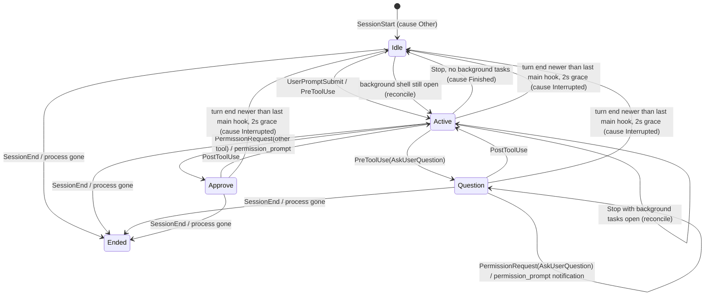

# Session Status Accuracy - Plan

## Goal Capsule

- **Objective:** A glance at the marsad dashboard tells the user correctly which sessions need them, which are still working, and which are done, and the dashboard can tell them by sound.
- **Product authority:** This plan covers status accuracy and alerts only (group A of four). Header token totals, the handoff context API, export/import, agent coordination, badges and sharing are separate plans and not active scope.
- **Open blockers:** None.

---

## Product Contract

### Summary

Status follows what each session is actually doing. Questions stay QUESTION, PERMISSION becomes APPROVE, Esc or an interrupt returns the row to IDLE, exited sessions show ENDED, and sessions with a background shell still running stay ACTIVE.
While the dashboard is open it plays one sound when a session starts waiting on the user and another when a session finishes its work.

### Problem Frame

Users keep marsad open beside several Claude Code sessions so they can tell, without switching windows, which one needs them.
Today the status lies in four observed ways, so they still have to check each terminal.

- An AskUserQuestion prompt shows PERMISSION, because Claude Code also fires a permission request and a "needs your permission" notification for it.
- Pressing Esc on a question or permission prompt, or interrupting a turn, fires no hook, so the row stays PERMISSION or ACTIVE until the next prompt.
- A session that has ended can keep showing ACTIVE.
- When Claude ends its turn but leaves a background shell running, the row shows IDLE even though work is still going on.

Nothing on screen gets the user's attention when a session needs them or finishes, unless they happen to be looking at the dashboard.

### Requirements

**Status correctness**

- R1. While an AskUserQuestion prompt is open, the session shows QUESTION, even when Claude Code also reports a permission request or permission notification for it.
- R2. When the user dismisses a question or permission prompt with Esc, or interrupts a turn, the session leaves QUESTION, APPROVE or ACTIVE and shows IDLE within a few seconds.
- R3. A session whose Claude Code process has exited shows ENDED within a few seconds, including sessions that never reported a SessionEnd.
- R4. After Claude ends its turn, a session that still has a background shell running (one Claude started with run in background) shows ACTIVE, and its activity names the running command. It returns to IDLE when the last background shell finishes and Claude has nothing left to do.
- R5. The status label PERMISSION is renamed APPROVE everywhere it appears: dashboard, `marsad status` table and JSON, README and the bundled marsad-usage skill.

**Alerts**

- R6. While the dashboard is open, it plays an attention sound when any session enters QUESTION or APPROVE.
- R7. While the dashboard is open, it plays a done sound when a session goes from working to IDLE because its turn finished. An Esc or interrupt (R2) and session start do not count as finishing.
- R8. The two sounds are distinguishable, use the platform's built-in sounds where available, and fall back to the terminal bell.
- R9. `m` toggles alerts on and off in the dashboard; the choice persists across restarts and the footer shows the current state. Alerts are on by default.
- R10. Opening the dashboard does not play sounds for states that already existed, and several sessions changing in the same moment play each sound at most once.
- R11. While the dashboard is open, a session entering QUESTION or APPROVE also raises a desktop notification naming the project and what it is waiting on, so the user learns of it on a locked screen when the OS shows notifications there. `m` mutes notifications together with sounds; R10 applies to notifications too.

### Key Decisions

- **Interrupts are detected from the transcript, not hooks.** Claude Code fires no hook for Esc or interrupts, but always writes a turn-end marker to the transcript. Governs R2, R7.
- **APPROVE replaces PERMISSION.** It says what the user must do and stays distinct from QUESTION. (session-settled: user-directed — chosen over WAITING, BLOCKED and NEEDS OK: WAITING does not say which kind of input is needed, since QUESTION also waits.) Governs R5.
- **Sounds play from the dashboard only.** One place to mute, no sounds from sessions the user is watching directly, no double-up with Claude Code's own notifications. (session-settled: user-directed — chosen over hook-side sounds and a configurable mix: one place to control it.) Governs R6, R9, R11.
- **Desktop notifications for sessions that need the user.** The user wants to hear about a waiting session while the screen is locked. (session-settled: user-directed — chosen over a phone push through ntfy.sh and over both: no accounts, no network.) Governs R11.
- **"Done" waits for background shells.** A turn that leaves a background shell running is not finished, so the done sound plays when the session truly goes IDLE. Governs R4, R7.
- **"Shell script" means background shells.** Foreground Bash already shows ACTIVE. User-typed `!` commands fire no hook and leave no transcript trace, so they stay out of scope. Governs R4.

### Acceptance Examples

- AE1. **Covers R1.** Given Claude calls AskUserQuestion, when Claude Code fires PermissionRequest for AskUserQuestion and then a permission_prompt notification, then the row stays QUESTION.
- AE2. **Covers R2, R7.** Given a row on QUESTION, when the user presses Esc, then within a few seconds the row shows IDLE and no done sound plays.
- AE3. **Covers R2.** Given a row on ACTIVE mid-turn, when the user presses Esc, then the row shows IDLE once the transcript records the interrupt.
- AE4. **Covers R3.** Given a session whose only pid-bearing event was lost, when its Claude Code process exits without SessionEnd, then the row shows ENDED within a few seconds.
- AE5. **Covers R4, R7.** Given Claude starts a background `cargo build` and ends its turn, when Stop fires, then the row stays ACTIVE with the command as activity and no done sound plays; when the build finishes and Claude's follow-up turn ends, the row shows IDLE and the done sound plays once.
- AE6. **Covers R6, R10.** Given three sessions already on APPROVE, when the dashboard opens, then no sound plays; when a fourth session then asks a question, the attention sound plays once.
- AE7. **Covers R9.** Given alerts are muted with `m`, when the dashboard restarts, then alerts are still muted and the footer says so.

### Scope Boundaries

- `/btw` side questions: Claude Code fires no hook and writes nothing to the transcript for them, so marsad cannot show a status. Listed under known limitations in the README instead.
- User-typed `!` shell commands: same reason.
- Phone push notifications, custom sound files and per-session alert rules.
- Desktop notifications on Windows (sound only there for now).
- Sounds when the dashboard is closed.

### Dependencies / Assumptions

- Claude Code sets `CLAUDE_PID` in hook subprocess environments, so every hook event can carry the session's process id (env-vars docs). If it is absent, the existing parent-process walk remains the fallback.
- Transcript turn-end markers (`system` entries with subtype `turn_duration`) appear after interrupts and rejected prompts. Observed in local transcripts; not documented.
- The transcript records background shell launches and their completion notifications. The transcript reader already parses task notifications.

### Outstanding Questions

**Deferred to Planning**

- Which platform sounds to use for each alert on macOS, Linux and Windows, and how to play them without blocking the UI.

### Sources / Research

- Hook event log evidence: `~/.claude/marsad/events.jsonl` shows PreToolUse(AskUserQuestion) → PermissionRequest(AskUserQuestion) → Notification(permission_prompt) for every question.
- Interrupted session transcript: tool_result "User rejected tool use", user text "[Request interrupted by user]", then system/turn_duration, with no further hooks until SessionEnd.
- Hook → status mapping: `src/events.rs`. Process liveness: `mark_exited` in `src/app.rs`. Pid capture: `claude_pid` in `src/hook.rs`. Turn tracking: `src/transcript.rs`.
- Claude Code docs: hooks, interactive mode (`/btw`, Esc), env vars (`CLAUDE_PID`, `CLAUDE_CODE_SESSION_ID`), status line.

---

## Planning Contract

Product Contract preservation: changed: R11 added and desktop notifications moved out of Scope Boundaries — the user asked for a locked-screen alert during planning and chose desktop notifications.

### Key Technical Decisions

- KTD1. **Every hook event carries the Claude Code pid, read from `CLAUDE_PID`.** Claude Code sets it in hook subprocesses, so reading the environment costs nothing; the existing parent-process walk stays as the fallback on SessionStart and UserPromptSubmit only. Any event can then repair a missing or stale pid, so `mark_exited` sees every live session's process. Serves R3.
- KTD2. **Status is reconciled from transcript facts after hook events, on every refresh.** Hooks set status as they do today; a reconcile step then corrects it from what the transcript reader knows: the time the last turn ended, and the open background tasks. It runs on every refresh, not only the 1 s transcript poll, so a Stop that leaves background work never flickers through IDLE. Serves R2, R4.
- KTD3. **A turn ending without Stop is an interrupt.** The transcript records a turn end (`system`/`turn_duration`, or an `[Request interrupted` user entry) for every turn, interrupted or not. When it is newer than the session's latest main-agent hook event (not `status_since`, which does not move on ACTIVE→ACTIVE events), is at least 2 s old, and the status is still working or waiting, the session goes IDLE marked as interrupted. The 2 s grace lets a normal turn's async Stop hook land first, so a normal finish is never mistaken for an interrupt and keeps its done sound. Serves R2, R7.
- KTD4. **Background tasks are tracked from the transcript, not hooks.** Any Bash tool result carrying `toolUseResult.backgroundTaskId` opens a task, whether Claude asked for `run_in_background` or Claude Code moved a timed-out command to the background. A `<task-notification>` with that `task-id` and any final `status` closes it, wherever it appears: a `user` entry, an `attachment` of type `queued_command` (text in `attachment.prompt`), or a `queue-operation` entry (text in `content`); the last two are how a notification absorbed mid-turn is recorded. Closing is idempotent. Background agents are not tracked, per the background-shell Key Decision. Serves R4.
- KTD5. **Why a session went IDLE is recorded with the status.** `Finished` (a Stop with no background task open), `Interrupted` (KTD3), or `Other` (session start, idle notifications). The alert detector plays the done sound only for a transition into IDLE caused by `Finished`. Serves R7.
- KTD6. **Alerts come from edge detection over sampled state.** After each refresh the dashboard compares each visible session's (status, status-since) with the previous sample: newly entering QUESTION or APPROVE (or a new prompt while already there) is attention; newly IDLE with cause `Finished` from a non-IDLE state is done. The first sample after start only seeds the map. Each sound plays at most once per refresh. The same attention edge also raises the desktop notification. Serves R6, R7, R10, R11.
- KTD7. **Sounds are fire-and-forget child processes.** macOS: `afplay` with `/System/Library/Sounds/Ping.aiff` (attention) and `Glass.aiff` (done). Linux: `paplay` (or `canberra-gtk-play`) with the freedesktop `message-new-instant` and `complete` sounds when present. Windows: PowerShell `[System.Media.SystemSounds]` Exclamation and Asterisk. If no player or file exists, write BEL to the terminal. Desktop notifications use the same fire-and-forget approach: `osascript -e 'display notification …'` on macOS and `notify-send` on Linux when present, with the text passed as arguments, never through a shell. Children get null stdio and are never awaited, so the UI never blocks. Serves R8, R11.
- KTD8. **A small `settings.json` in marsad's data dir holds user preferences**, starting with `alerts` (default on). Group B adds its context-warning threshold to the same file and exports it. `history.json` (retention) and `update.json` stay where they are. Serves R9.
- KTD9. **The status enum variant is renamed `Approve`, serialized `approve`.** `marsad status --format json` changes `permission` to `approve`; the bundled skill documents the new value. No alias, because the only documented consumer is the bundled skill, which ships in the same release. Serves R5.

### High-Level Technical Design

### Assumptions

- Transcript timestamps and hook timestamps come from the same machine clock, so comparing a turn-end time to hook times is meaningful. A skew of a second or two only delays R2.
- A normal turn's Stop hook reaches `events.jsonl` within 2 s of the turn's `turn_duration` entry (KTD3 grace).
- When a background task finishes while Claude is idle, Claude Code starts a follow-up turn (UserPromptSubmit with the notification as prompt, then Stop). Observed in `events.jsonl`; that Stop produces the done sound.

---

## Implementation Units

### U1. Pid on every hook event

- **Goal:** Every event records the Claude Code process id so ended sessions are detected.
- **Requirements:** R3
- **Dependencies:** none
- **Files:** `src/hook.rs`
- **Approach:** In `trim`, insert `pid` from `CLAUDE_PID` for every event when it parses as a number; otherwise keep the existing `claude_pid()` walk for SessionStart and UserPromptSubmit. `events::apply` already takes the latest `pid`.
- **Patterns to follow:** existing `trim` field handling.
- **Test scenarios:**
  - `trim` on a PreToolUse event with `CLAUDE_PID=4242` in the environment yields `pid: 4242`.
  - With `CLAUDE_PID` unset or not a number, a PreToolUse event has no `pid`.
  - Covers AE4. A session whose first event had no pid gets one from a later event (events test: SessionStart without pid, then PreToolUse with pid → `session.pid` set).
- **Verification:** unit tests pass; a live session's events in `events.jsonl` carry `pid`.

### U2. Questions stay QUESTION; PERMISSION becomes APPROVE

- **Goal:** Correct the question/permission mix-up and rename the label.
- **Requirements:** R1, R5
- **Dependencies:** none
- **Files:** `src/model.rs`, `src/events.rs`, `src/ui.rs`, `src/live.rs`, `assets/SKILL.md`, `README.md`
- **Approach:**
  1. Rename `Status::Permission` to `Status::Approve` with `as_str` `approve` (KTD9); `needs_user` and ordering unchanged.
  2. In `events::apply`, `PermissionRequest` whose `tool_name` is `AskUserQuestion` sets QUESTION (keeping the question as detail), and a `permission_prompt` notification leaves a session already in QUESTION unchanged.
  3. UI label `APPROVE`; README status table and example, known-limitations wording, and the skill's status list updated.
- **Patterns to follow:** existing match arms and tests in `src/events.rs`.
- **Test scenarios:**
  - Covers AE1. PreToolUse(AskUserQuestion) → PermissionRequest(AskUserQuestion) → Notification(permission_prompt) leaves status QUESTION with the question as detail.
  - PreToolUse(Bash) → PermissionRequest(Bash) gives APPROVE with detail `Bash: …` (existing test, renamed).
  - Notification(permission_prompt) with no prior question gives APPROVE.
  - `Status::Approve.as_str()` is `approve`; sorting still puts APPROVE before QUESTION.
- **Verification:** `rg -i permission` shows no user-facing PERMISSION label left outside Claude Code event names and permission modes.

### U3. Transcript reports turn ends and open background tasks

- **Goal:** The transcript reader exposes when the last turn ended and which background tasks are still running.
- **Requirements:** R2, R4
- **Dependencies:** none
- **Files:** `src/transcript.rs`, `src/model.rs`
- **Approach:**
  1. Record the unix time of the latest turn end: a `system`/`turn_duration` entry, or a user entry starting `[Request interrupted`. Expose it on `TranscriptStats` (KTD3).
  2. Track background tasks (KTD4): remember the command summary of every Bash tool_use by id; when its tool_result carries `toolUseResult.backgroundTaskId`, open a task under that id. Close a task from a `<task-notification>` with its `task-id` and a `status`, found in a `user` entry, an `attachment` entry of type `queued_command` (`attachment.prompt`), or a `queue-operation` entry (`content`).
  3. Expose the open tasks (id → short label) on `TranscriptStats`, in launch order.
- **Patterns to follow:** `task_notification`, `tag`, and the `pending` map handling in `src/transcript.rs`; transcript tests at the bottom of the file.
- **Test scenarios:**
  - A background Bash launch followed by its tool_result leaves one open task labelled with the command.
  - A later `<task-notification>` with that task-id and `status` completed leaves no open tasks.
  - A notification with status failed or killed also closes it.
  - A task closed only by a `queued_command` attachment's notification (absorbed mid-turn) leaves no open tasks; the same notification also seen in a `queue-operation` entry is harmless.
  - A Bash tool_use without `run_in_background` whose result carries `backgroundTaskId` and `timedOutAfterMs` (moved to the background on timeout) opens a task.
  - A background agent launch ("Async agent launched …") opens no task.
  - A notification for an unknown task-id changes nothing.
  - A `turn_duration` entry sets the turn-end time to its timestamp; an `[Request interrupted by user]` entry does the same.
  - A foreground Bash call opens no task.
- **Verification:** transcript unit tests pass.

### U4. Reconcile status from the transcript

- **Goal:** Interrupts go IDLE, background work stays ACTIVE, and the IDLE cause is recorded.
- **Requirements:** R2, R4, R7
- **Dependencies:** U2, U3
- **Files:** `src/model.rs`, `src/events.rs`, `src/app.rs`, `src/live.rs`
- **Approach:**
  1. Add an IDLE cause to `Session` (KTD5), set by `set_status` callers: Stop → Finished; SessionStart and `idle_prompt` → Other. Record the time of the latest main-agent hook event (events without `agent_id`) in `events::apply`.
  2. Add `Session::reconcile(now)` (KTD2), in this order:
     - QUESTION or APPROVE with a turn end newer than the latest main-agent hook and at least 2 s old (KTD3) → IDLE (Interrupted), whatever background tasks are open.
     - ACTIVE with such a turn end and no background task open → IDLE (Interrupted).
     - IDLE with background tasks open → ACTIVE with detail `background: <label>` (and `+N` when several).
     IDLE (Finished) comes only from a Stop with no task open; when the last task closes the row stays ACTIVE until the follow-up turn's Stop.
  3. Call it for every session after events are applied in `App::refresh` and after transcripts load in `live::load_sessions`.
  4. `mark_exited` is unchanged; U1 makes its pid path the common case.
- **Patterns to follow:** `Session::set_status`, `running_secs` tests in `src/model.rs`.
- **Test scenarios:**
  - Covers AE2. QUESTION from a hook at t=10, turn end at t=12, reconciled at t=15 → IDLE with cause Interrupted.
  - Same, reconciled at t=13 (inside the 2 s grace) → still QUESTION.
  - QUESTION with a background task open, turn end at t=12, reconciled at t=15 → IDLE (Interrupted), then the background rule makes it ACTIVE.
  - Covers AE3. ACTIVE at t=10, turn end at t=12, reconciled at t=15 → IDLE (Interrupted).
  - ACTIVE at t=10, Esc turn end at t=12, UserPromptSubmit at t=13 → stays ACTIVE (turn end older than the latest hook).
  - Normal finish: turn end at t=12 and Stop at t=12.5 → IDLE with cause Finished, never Interrupted.
  - Covers AE5. Stop with one open background task → ACTIVE, detail `background: cargo build`; task closed → still ACTIVE; follow-up UserPromptSubmit then Stop → IDLE (Finished).
  - IDLE with background open and a user-typed new prompt → ACTIVE from the hook; reconcile leaves it ACTIVE.
  - ENDED sessions are never changed by reconcile.
- **Verification:** model and events tests pass; a manual Esc on a question in a live session turns the row IDLE within about a second.

### U5. Alert sounds with mute

- **Goal:** The dashboard plays an attention sound and a done sound and raises a desktop notification for sessions that need the user, with `m` to mute.
- **Requirements:** R6, R7, R8, R9, R10, R11
- **Dependencies:** U4
- **Files:** `src/alerts.rs` (new), `src/settings.rs` (new), `src/main.rs`, `src/app.rs`, `src/ui.rs`
- **Approach:**
  1. `settings.rs`: load and save `settings.json` in `data_dir()` as a JSON object, keeping unknown keys; `alerts` boolean defaults to true (KTD8).
  2. `alerts.rs`: a detector holding the last sample per session id; `observe(sessions) -> (attention, done)` per KTD6; `play(kind)` per KTD7 with the BEL fallback; and `notify(title, body)` per KTD7 for each session that raised attention.
  3. `App` owns the detector and the alerts flag; after each refresh it observes visible sessions and plays sounds and raises notifications when enabled. `m` toggles and saves the flag; the list footer shows `m alerts: on/off`.
- **Patterns to follow:** `store::retention`/`set_retention` file handling; key handling and footer entries in `src/app.rs` and `src/ui.rs`.
- **Test scenarios:**
  - Covers AE6. First observation of sessions already on APPROVE yields no alerts.
  - A session moving ACTIVE → QUESTION yields attention once; observing again yields nothing.
  - A session going APPROVE → ACTIVE → APPROVE across observations yields attention each time it enters APPROVE.
  - Attention lists each session that raised it, so a notification names its project and detail; two sessions entering QUESTION together yield one sound and two notifications.
  - ACTIVE → IDLE (Finished) yields done; ACTIVE → IDLE (Interrupted) yields nothing.
  - A session first seen in IDLE yields nothing.
  - Covers AE7. Settings round-trip: saving `alerts: false` then loading returns false and preserves another key.
  - Missing or corrupt `settings.json` loads defaults.
- **Verification:** unit tests pass; manual run on macOS plays Ping and shows a notification when a session asks a question, and plays Glass when it finishes.

### U6. Documentation and changelog

- **Goal:** Users can find the new behavior and the known limits.
- **Requirements:** R5, R9, and the `/btw` and `!` scope boundaries
- **Dependencies:** U1–U5
- **Files:** `README.md`, `CHANGELOG.md`, `assets/SKILL.md`
- **Approach:** README: status table (APPROVE, interrupt and background rows, the cause of ENDED), keys line (`m`), a short "Alerts" paragraph (sounds and desktop notifications, and that macOS shows them on the lock screen only if allowed in its notification settings), and known limitations (no status for `/btw` or `!` commands; drop the outdated PERMISSION-after-approval line only if it is no longer true). CHANGELOG `## Unreleased` bullets. Skill status values.
- **Test expectation:** none -- documentation only.
- **Verification:** README examples match the UI.

---

## Verification Contract

| Gate | Command | Applies to |
|---|---|---|
| Unit tests | `cargo test` | all units |
| Lints | `cargo clippy --all-targets -- -D warnings` | all units |
| Format | none: the repo is not rustfmt-clean, so match surrounding style by hand and do not run `cargo fmt` | all units |
| Live smoke | run `cargo run` with a live session; ask a question and press Esc; start a background `sleep 20` | U1, U4, U5 |

---

## Definition of Done

- Every requirement R1–R11 is met and its acceptance example is covered by a test or the live smoke.
- `cargo test` and `cargo clippy --all-targets -- -D warnings` pass.
- README, CHANGELOG and the bundled skill describe APPROVE, sounds, desktop notifications, `m`, and the `/btw` and `!` limits.
- No experimental or abandoned code is left in the diff.
