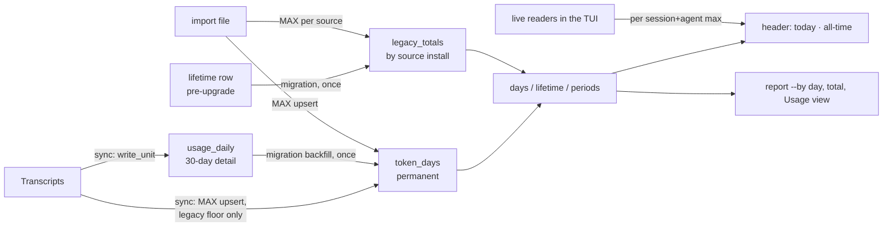
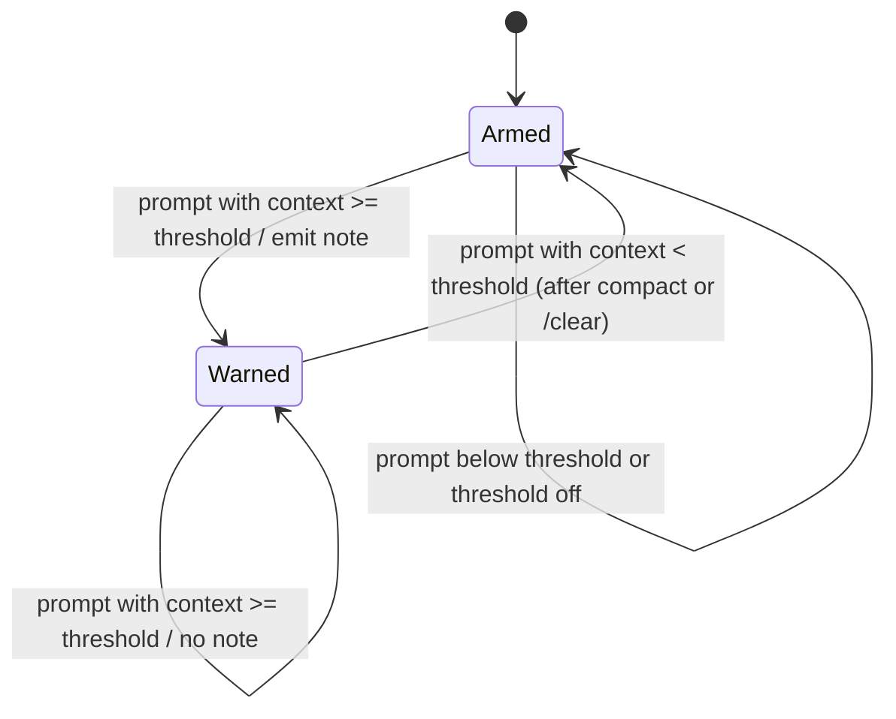

# Token Counter, Handoff Context and Data Portability - Plan

## Goal Capsule

- **Objective:** Users can see and keep their real token usage from their first day onward: today and all-time at a glance, any week or month later, on any machine. Sessions can find out when their context is nearly full so they hand off before auto-compact.
- **Product authority:** This plan covers group B of four. Status accuracy (A), agent coordination (C), and badges and sharing (D) are separate plans. D consumes the counter defined here.
- **Open blockers:** None.

---

## Product Contract

### Summary

A permanent day-by-day token counter that outlives the 30-day detail history feeds the header (`today · all-time`) and later the share and badge features.
`marsad context` tells a session its own token use and context left, and an automatic one-line warning reaches the session when its context crosses a threshold.
`marsad export` and `marsad import` move all marsad data between machines.

### Problem Frame

The header's `Σ` figure sums only the sessions currently on screen, so it shrinks when sessions end and says nothing about the day or the user's history.
Per-day detail is pruned after 30 days, and pruned days survive only as one all-time sum, so weekly or monthly figures older than a month are lost.
The user wants these numbers to show recruiters and clients how much AI-assisted work they do, which only works if the history is permanent.

Long sessions also lose output quality when Claude Code auto-compacts. A session could write a handoff prompt for a fresh session first, but it has no way to know how close it is to the compaction point.

Finally, all marsad data lives on one machine with no way to back it up or move it.

### Requirements

**Permanent token counter**

- R1. marsad keeps token totals per local calendar day (input, output, cache read, cache write, total), and retention pruning never deletes them.
- R2. The counter starts at the earliest usage marsad can index, including transcripts that predate installing marsad, and grows as new usage is indexed.
- R3. Existing all-time totals from earlier versions are preserved on upgrade, so the all-time figure never drops.
- R4. The header shows today's tokens (local timezone) and the all-time total in place of the visible-sessions sum. Today's figure includes usage from live sessions not yet indexed.
- R5. Usage history, `marsad total` and `marsad report --by day` read daily totals from the counter, so periods longer than the retention still have per-day numbers.
- R6. The counter answers totals and per-day averages for today, the last 7 days, the last 30 days and all time, for use by the share feature.

**Handoff context**

- R7. `marsad context` prints the calling session's tokens used, context used, context left before auto-compact and percent full, as text or JSON. With no arguments it identifies the session it runs in; a session id can be passed explicitly.
- R8. When a session's context crosses the warning threshold, the session's next prompt carries a one-line note telling Claude how full the context is and suggesting it write a handoff now.
- R9. The warning fires once per crossing. It fires again only after the context drops below the threshold (for example after a compact or `/clear`) and rises past it again.
- R10. The threshold defaults to 80% of the auto-compact point and can be changed or turned off with a marsad command.
- R11. The bundled marsad-usage skill documents `marsad context` and the handoff pattern.

**Export and import**

- R12. `marsad export [file]` writes one file holding the permanent counter, the kept session and skill history, and marsad settings (retention, alert mute, context warning threshold).
- R13. `marsad import <file>` merges an export into the local data. Importing the same file twice, or an export taken from this machine, never double counts tokens.
- R14. Import reports what it added and skips data it cannot read without failing the rest.

### Key Decisions

- **Day totals are permanent; detail stays 30 days.** Tokens per day are tiny (about 15 KB a year), while session and skill detail is what grows. (session-settled: user-directed — chosen over keeping only an all-time sum: recruiters need weekly, monthly and per-day figures.) Governs R1, R5.
- **Day one is the earliest indexed usage, not the install date.** Pre-install transcripts are real work the user did. (session-settled: user-approved — chosen over counting only from install.) Governs R2.
- **Context warnings are pushed, not only pulled.** Sessions forget to check, so marsad adds the note itself, in addition to the `marsad context` command. (session-settled: user-approved — chosen over command-only and command plus a handoff skill.) Governs R7, R8.
- **Export means a full move or backup.** (session-settled: user-approved — chosen over counter-only export and analysis-only CSV dumps.) Governs R12, R13.
- **Imports merge rather than replace.** Whichever source has the larger figure for a session-day wins. That keeps re-import idempotent and safe when both machines saw the same session. Governs R13.

### Acceptance Examples

- AE1. **Covers R1, R5.** Given retention is 30 days and the user used 3M tokens 45 days ago, when they open Usage with the "all" period, then that day still shows 3M even though its sessions are gone.
- AE2. **Covers R3.** Given an existing install whose pruned all-time sum is 50M, when the user upgrades, then `marsad total` still reports at least 50M.
- AE3. **Covers R4.** Given a session that used 200k tokens in the last minute and has not been indexed yet, when the header refreshes, then today's figure includes those 200k.
- AE4. **Covers R8, R9.** Given the threshold is 80%, when a session's context goes from 78% to 83%, then the next prompt carries the note once; at 90% no second note appears; after `/compact` drops it to 20% and it later passes 80% again, the note appears again.
- AE5. **Covers R13.** Given an export from machine A, when it is imported on machine B twice, then B's totals increase once.

### Scope Boundaries

- Cloud sync or automatic backup.
- Exporting raw transcripts (Claude Code owns those).
- Spending or cost estimates in money.
- Per-project permanent counters; the permanent counter is per day only.

### Dependencies / Assumptions

- Claude Code sets `CLAUDE_CODE_SESSION_ID` in Bash tool and hook environments, which lets `marsad context` identify its own session.
- A synchronous (non-async) hook's output on prompt submit is added to the session's context. marsad's existing hooks are async and cannot do this, so this needs one additional hook registration.
- Days pruned by earlier versions only kept an all-time sum, so they cannot be split back into days. They count toward all-time totals but not toward any day.

### Outstanding Questions

**Deferred to Planning**

- Export file format and versioning.
- How the header obtains live, not-yet-indexed usage cheaply.

### Sources / Research

- Header total: `draw_header` in `src/ui.rs`. Lifetime and pruning: `prune` and `lifetime` in `src/store.rs`. Retention: `store::retention`.
- Context math: `context_info` and `auto_compact_window` in `src/model.rs`; status line snapshots in `src/statusline.rs`.
- Hook registration: `EVENTS` and `install` in `src/install.rs`.

---

## Planning Contract

Product Contract preservation: unchanged. Both deferred questions (export format; live usage for the header) are resolved below as KTD9 and KTD5.

### Key Technical Decisions

- KTD1. **The permanent counter is a new `token_days` table keyed by (session, agent, day), never pruned.** It holds the four token columns, total and turns. Re-indexing a transcript replaces that unit's rows outside the legacy-blocked ranges (KTD4), exactly as `usage_daily` is replaced today, so a timezone change can't leave the same tokens under two days. Import upserts with per-column MAX, so importing the same rows twice changes nothing (R13). The per-(session, agent) key exists only to make that merge idempotent; a per-day-only table can't tell two sources' rows apart. It costs low megabytes a year rather than the Product Contract's 15 KB estimate. Users still see the counter per day only. Serves R1, R2, R13.
- KTD2. **Totals pruned by earlier versions become a "legacy" row keyed by the install that pruned them.** A new `legacy_totals` table (source id, since, through, token columns) receives the current `lifetime` row at migration, tagged with this install's id. A random id is generated once (INSERT OR IGNORE, never overwritten) and stored in a new `meta` table in `usage.db`; it never lives in `settings.json`. The `lifetime` table stays, frozen as pre-upgrade data, and is no longer written; its schema comment says so. Keying by source lets import merge another machine's legacy figure with MAX instead of adding it twice. All-time = SUM(legacy_totals) + SUM(token_days). Serves R3, R13.
- KTD3. **Migration backfills `token_days` from `usage_daily` once, in one IMMEDIATE transaction that reads the schema version in `meta` after taking the write lock and returns early when it is current.** A deferred transaction would let two first openers both migrate (two legacy rows) or fail with a stale-snapshot busy error. `open_readonly` runs the migration through a normal open first when the version is missing, so `--no-sync` reads never hit missing tables. All-time can't drop on upgrade, because the backfill plus the copied legacy row equal the old `lifetime()` result exactly (AE2). Serves R3.
- KTD4. **Retention prunes detail only.** `prune` stops folding into `lifetime`, and it stops deleting `files` rows, so old transcripts aren't re-read every sync. `sync_dir` stops skipping files older than the retention, so pre-install transcripts reach `token_days` (R2). `usage_daily` and `skill_runs` keep their retention floor. `token_days` skips only days inside a blocking legacy row's `[since, through)` range, both when indexing and when importing. A legacy row blocks when it is this install's own, or when its source was imported with `marsad import --restore` (recorded as `restored:<source>` in `meta`). A restore also deletes local `token_days` rows inside the restored ranges. Days before `since` were never counted anywhere, so pre-install transcripts still reach the counter (R2). A plain import never blocks or deletes this machine's days: another machine's legacy sum covers only that machine's sessions, and a global block erased the importer's own usage on those dates (found in review). `--restore` covers the case R13 needs: a reinstall with the old transcripts still on disk, where the same sessions would otherwise count in the legacy sum and again in `token_days`. The remaining cost is an undercount in one rare case: rows imported from another machine on days inside this install's own pre-0.4 pruned range are dropped. Session-settled: user-approved, the `--restore` flag chosen over per-source session scoping and over blocking only the local range. Serves R1, R2, R13.
- KTD5. **The header overlays live usage on the indexed counter per (session, agent).** The app keeps a cached counter snapshot: today's indexed rows per (session, agent), plus the all-time sum. It reloads after each background sync. On each draw, today's figure takes, for each (session, agent), the larger of the indexed value and the live reader's figure for today. All-time adds the same deltas. The live readers already exist, so this costs no extra I/O. Serves R4, AE3.
- KTD6. **Day-based reads move to `token_days`.** These are `store::days`, `first_day`, `lifetime`, the Usage view's day list, and `report --by day`. Session, skill, project, model and agent breakdowns stay on `usage_daily`, which keeps its 30-day detail. A new `store::periods` returns totals and per-day averages for today, 7 days, 30 days and all time. Averages divide by calendar days in the period; all-time counts from the first counted day. Serves R5, R6.
- KTD7. **`marsad context` finds its session in this order:** `--session <id>`, then the `CLAUDE_CODE_SESSION_ID` environment variable, then the Claude Code pid. The pid comes from `CLAUDE_PID` or a walk up the parent processes, matched against the pids recorded by hooks. Session state is rebuilt the way `marsad status` does, through `live::load_sessions`, so context math matches the dashboard (`Session::context`). Serves R7.
- KTD8. **The warning is a second, synchronous `UserPromptSubmit` hook running `marsad context --hook`.** It reads hook JSON on stdin and needs no session lookup. Context comes from whichever of the status-line snapshot (`status/<id>.json`) and a bounded read of the transcript's tail reported more recently, the same rule `Session::context` uses, so the hook and `marsad context` agree and a post-compact drop re-arms the warning. It prints `hookSpecificOutput.additionalContext` JSON only when the session newly crosses the threshold. A per-session marker file under `context-warned/` in the data dir means "warned", so concurrent sessions never overwrite each other's state; markers older than 30 days are removed by the hook. A prompt below the threshold clears the flag, which re-arms the warning (R9). Every failure exits 0 with no output, so the session is never disturbed. `install` registers it without `async`; `uninstall` and `is_ours` recognize it. Serves R8, R9.
- KTD9. **Export is one versioned JSON file.** The top-level object has `marsad_export: 1`, `exported_at`, `source` (install id), `settings`, `legacy_totals`, `token_days`, `sessions`, `usage_daily` and `skill_runs`. JSON matches the rest of marsad's files. It needs no new dependency, and a year of data stays a few MB. Import refuses an unknown major version. It merges each section independently in one transaction per section and reports added and updated counts and skipped rows. Token tables use the MAX upsert (KTD1). `skill_runs` keep the larger total per key, `sessions` fill missing fields, and legacy rows use MAX per source. Serves R12, R13, R14, AE5.
- KTD10. **Retention moves into `settings.json`.** `store::retention` reads `retention_days` from settings and falls back to `history.json` once. `set_retention` writes settings and removes `history.json`. Export then carries all preferences from one file: `retention_days`, `alerts` and `context_warning_pct`. On import, a setting is applied only when it is not already set locally, so a backup can't silently change the current machine's choices. The export's `source` install id is never adopted locally. Serves R10, R12.

### High-Level Technical Design

Data flow for the counter:

Context warning state per session:

### Assumptions

- `UserPromptSubmit` output from a non-async hook, given as `hookSpecificOutput.additionalContext`, is added to the prompt's context. Verify against the Claude Code hooks reference during U6; plain stdout is the fallback.
- `CLAUDE_CODE_SESSION_ID` may not be set in Bash tool subprocesses. KTD7's pid fallback covers that case.
- The status-line snapshot is refreshed after each assistant message, so at prompt time it reflects the end of the previous turn.
- Importing settings only when unset locally, and averaging over calendar days, are planning defaults the user didn't specify. Both are easy to change.
- The warning reaches a session only at its next prompt (R8). A long autonomous turn can reach auto-compact before then. Delivering it mid-turn too (a PostToolUse hook can also add context) would change R8, so it is left as a possible follow-up.

---

## Implementation Units

### U1. Preferences in one settings file

- **Goal:** Retention and the context-warning threshold live in `settings.json` next to `alerts`.
- **Requirements:** R10, R12 (KTD10)
- **Dependencies:** none
- **Files:** `src/settings.rs`, `src/store.rs`, `src/report.rs`
- **Approach:**
  1. Add typed getters and setters in `settings.rs` for `retention_days` (absent = default 30, `null` = forever) and `context_warning_pct` (default 80, `false` = off), mirroring `alerts`.
  2. `store::retention` / `set_retention` delegate to settings. The first time `retention()` finds no settings key and a `history.json`, it copies the value into settings and deletes `history.json`, so the local choice counts as set before any import merge.
  3. Expose a whole-file read and a "set keys absent locally" merge for export/import (U7).
- **Patterns to follow:** `alerts_at` / `set_at` path-injected helpers for tests.
- **Test scenarios:**
  - A settings file without `retention_days` and a `history.json` with 14 returns 14, after which settings holds 14 and `history.json` is gone; `set_retention(Some(7))` then stores 7.
  - `retention_days: null` reads as forever; missing everywhere reads as 30.
  - `context_warning_pct` defaults to 80, reads `false` as off, and round-trips 70.
  - The merge sets only keys missing locally; a retention migrated from `history.json` counts as set and is not overwritten.
- **Verification:** `marsad retention` shows and sets values as before.

### U2. Permanent counter in the store

- **Goal:** Token totals per day survive pruning, include pre-install transcripts, and never drop on upgrade.
- **Requirements:** R1, R2, R3 (KTD1–KTD4)
- **Dependencies:** none
- **Files:** `src/store.rs`
- **Approach:**
  1. Schema: add `token_days` (with `turns`), `legacy_totals` and `meta` to `SCHEMA` with column comments (they are shown by `marsad schema`). Mark `lifetime` as frozen pre-upgrade data superseded by `legacy_totals`.
  2. `open_at` runs the KTD3 migration: create the install id if absent; copy `lifetime` into `legacy_totals` under it; backfill `token_days` from `usage_daily`; set the version. `open_readonly` triggers it when the version is missing.
  3. `write_unit` replaces the unit's `token_days` rows for every day outside the legacy-blocked ranges (KTD4), independent of the retention floor.
  4. `prune` deletes detail only; it no longer touches `lifetime` or `files`.
  5. `sync_dir` drops the old-mtime skip.
  6. `lifetime()` = SUM(legacy_totals) + SUM(token_days), `since` = min of both.
- **Execution note:** Write the upgrade test first: build a pre-upgrade database with pruned `lifetime` and live `usage_daily`, open it, assert all-time is unchanged.
- **Patterns to follow:** existing store tests that call `sync_dir` against a temp projects dir with fixed retention.
- **Test scenarios:**
  - Covers AE2. A pre-upgrade DB with `lifetime.total` 50 and `usage_daily` total 7 reports 57 after opening, and again after a second open; running the migration twice leaves exactly one `legacy_totals` row.
  - A pre-upgrade DB read through `open_readonly` first (no sync) migrates and answers `lifetime()`.
  - Covers AE1. With retention 30, a transcript whose usage is 45 days old lands in `token_days` and `days()` lists that day; `usage_daily` has no row for it.
  - Re-syncing a grown transcript raises that day's `token_days` total; re-syncing an unchanged one leaves it equal.
  - With a legacy row since D10, through D40, transcript day D20 is not inserted into `token_days` and day D5 is.
  - After prune, `files` still holds the old transcript, so the next sync does not re-read it (`updated` = 0).
- **Verification:** `marsad total` on a real install reports at least the previous figure.

### U3. Day-based views read the counter

- **Goal:** Usage history, `marsad total` and `report --by day` have per-day numbers beyond retention, and the counter answers period totals and averages.
- **Requirements:** R5, R6 (KTD6)
- **Dependencies:** U2
- **Files:** `src/store.rs`, `src/report.rs`, `src/usage.rs`
- **Approach:**
  1. Point `days`, `first_day` and the `By::Day` report query at `token_days`; `turns` keeps the report's columns unchanged. The existing project filter still joins `sessions`, so it covers only sessions whose detail is kept; this is not a per-project permanent counter.
  2. Add `store::periods(conn, today)` returning total and per-day average for today, 7, 30 and all time.
  3. `marsad total` prints the periods (table, JSON, CSV).
  4. The Usage view's "all" period lists every counted day; the retention-based period limits stay.
- **Patterns to follow:** `Days` range helpers; `Format` handling in `report::total`.
- **Test scenarios:**
  - `periods` over days with totals 10 (today), 20 (3 days ago) and 60 (40 days ago) returns today 10, 7-day 30 (avg 30/7), 30-day 30, all-time 90 averaged over 41 days.
  - With no usage, `periods` returns zeros and no all-time start.
  - `report --by day` lists a day older than retention.
  - `total --format json` includes the periods and keeps the existing fields.
- **Verification:** Usage view shows days older than retention when they exist.

### U4. Header shows today and all-time

- **Goal:** The header's token figure is `today · all-time`, live.
- **Requirements:** R4 (KTD5)
- **Dependencies:** U2
- **Files:** `src/app.rs`, `src/ui.rs`, `src/store.rs`, `src/transcript.rs`
- **Approach:**
  1. A store query returns today's rows per (session, agent) plus the all-time sum.
  2. `App` caches it and reloads after `usage` reports a finished sync, and on start.
  3. A pure function merges cached rows with live readers' today figures (main and subagent readers, keyed the same way the indexer keys them). It keeps the larger figure per key and returns (today, all-time).
  4. `draw_header` replaces `Σ … tokens` with `today X · all-time Y`.
- **Patterns to follow:** `rate_spans` styling in `draw_header`; `reader.daily()` as used by `write_unit`.
- **Test scenarios:**
  - Covers AE3. Cached today 1.0M with a live reader at 1.2M for the same key yields 1.2M today and all-time + 0.2M.
  - A live session with no cached row adds its whole figure to both totals.
  - A cached row with a smaller live value keeps the cached value.
  - Usage from yesterday in a live reader does not count toward today.
- **Verification:** with a session running, the header's today figure moves while the session works.

### U5. `marsad context`

- **Goal:** A session can ask how much context it has left.
- **Requirements:** R7, R10 (KTD7)
- **Dependencies:** U1
- **Files:** `src/main.rs`, `src/context.rs` (new), `src/live.rs`
- **Approach:**
  1. New subcommand with `--session`, `--format text|json`, and `--warn <pct|off>`. `--warn` sets the threshold and prints it.
  2. Resolve the session per KTD7, using `live::load_sessions` (made `pub(crate)`) and the hook-recorded pids.
  3. Print tokens used, context used, context left before auto-compact, percent full, and whether the window is estimated.
  4. Exit non-zero with a clear message when no session matches.
- **Patterns to follow:** `live::status` output and JSON shape; `hook::claude_pid` parent walk.
- **Test scenarios:**
  - A session map containing pid 42 resolves when the ancestor list contains 42; an explicit id wins over the pid.
  - JSON output for a session at 160k of a 200k compact limit reports 80% and 40k left.
  - An unknown session id returns an error naming the id.
  - `--warn off` then `--warn 75` round-trips through settings.
- **Verification:** running `marsad context` from a Bash tool inside a live session prints that session.

### U6. Automatic context warning

- **Goal:** A session's next prompt carries a one-line handoff note when its context crosses the threshold, once per crossing.
- **Requirements:** R8, R9, R10 (KTD8)
- **Dependencies:** U1, U5
- **Files:** `src/context.rs`, `src/install.rs`, `src/statusline.rs`
- **Approach:**
  1. `context --hook` reads stdin and computes percent full from the fresher of the snapshot and a bounded tail read of the transcript (KTD8). It then applies the armed/warned state machine and prints the note as `additionalContext` JSON.
  2. Warned state is a per-session marker file (KTD8).
  3. `install` adds a second `UserPromptSubmit` entry without `async`. `is_ours` matches it too, so reinstall stays idempotent and `uninstall` removes both.
  4. The note names the percent and suggests writing a handoff now, e.g. "Context is 83% full (auto-compact at 100%). Write a handoff prompt for a fresh session before continuing."
- **Patterns to follow:** `statusline::save` atomic write; existing `install`/`strip` tests on settings maps.
- **Test scenarios:**
  - Covers AE4. A sequence of prompts at 78%, 83% and 90%, then 20% and 85%, emits a note at 83% and 85% only.
  - Threshold off emits nothing at 99%.
  - A transcript tail newer than the snapshot and below the threshold re-arms the warning even though the older snapshot is above it.
  - Missing snapshot and transcript, malformed stdin, or an unwritable state file each produce no output and success.
  - Installing twice leaves exactly one sync and one async marsad entry under `UserPromptSubmit`; uninstall removes both and keeps foreign hooks.
- **Verification:** in a live session past the threshold, Claude's next reply acknowledges the note; the hook adds no noticeable prompt latency.

### U7. Export and import

- **Goal:** All marsad data moves between machines, and re-import never double counts.
- **Requirements:** R12, R13, R14 (KTD9, KTD10)
- **Dependencies:** U1, U2
- **Files:** `src/main.rs`, `src/portable.rs` (new), `src/store.rs`, `src/settings.rs`
- **Approach:**
  1. `marsad export [file]` writes the KTD9 JSON (default name `marsad-export-YYYY-MM-DD.json` in the current dir) after a sync.
  2. `marsad import <file>` validates `marsad_export`, then merges each section and prints a summary per section: added, updated, skipped.
  3. A bad row is skipped and counted, never fatal; a bad section is reported and the rest continue.
- **Patterns to follow:** `write_unit` transactions; `report` output style.
- **Test scenarios:**
  - Covers AE5. Importing machine A's export into B twice raises B's all-time once.
  - Importing this machine's own export changes nothing.
  - A's legacy row merges into B as a second source; importing it again keeps one row.
  - B indexed a copy of A's transcripts first: importing A's export removes B's `token_days` rows inside A's legacy range, so all-time counts those days once.
  - A file with `marsad_export: 2` is refused with a version message; a non-JSON file is refused.
  - A `token_days` row with a missing total is skipped and counted; other rows still import.
  - Imported settings fill unset keys only.
- **Verification:** export then import into a fresh `MARSAD_HOME` reproduces `marsad total`.

### U8. Documentation

- **Goal:** Users and the bundled skill know the new numbers and commands.
- **Requirements:** R11, and the user-facing parts of R4, R7, R10, R12
- **Dependencies:** U1–U7
- **Files:** `README.md`, `CHANGELOG.md`, `assets/SKILL.md`
- **Approach:** README: header figure, `marsad context` (with `--warn`), the automatic warning, export/import, and retention now affecting detail only. CHANGELOG `## Unreleased` bullets. SKILL.md: `marsad context` and the handoff pattern; replace the "all time = `lifetime` + `SUM(usage_daily)`" formula with SUM(`legacy_totals`) + SUM(`token_days`), and describe `lifetime` as frozen.
- **Test expectation:** none -- documentation only.
- **Verification:** commands and flags in the docs match `--help`.

---

## Scope Boundaries

### Deferred to Follow-Up Work

- Share text and badges built on `store::periods` (group D).

---

## Risks

- **Migration on a live database.** The dashboard and hook-triggered syncs may open `usage.db` together. The IMMEDIATE transaction (KTD3) makes a second opener wait on the busy timeout, then see the version set and skip.
- **Prompt latency.** The sync hook runs before every prompt. It reads only small files in the common case; the transcript fallback is bounded.
- **First sync after upgrade reads every transcript once** (KTD4). That is bounded by Claude Code's own cleanup period, and it runs in the background in the TUI.

---

## Verification Contract

| Gate | Command | Applies to |
|---|---|---|
| Unit tests | `cargo test` | all units |
| Lints | `cargo clippy --all-targets -- -D warnings` | all units |
| Format | none: the repo is not rustfmt-clean, so match surrounding style by hand and do not run `cargo fmt` | all units |
| Upgrade smoke | copy the real `~/.claude/marsad` to a temp `MARSAD_HOME`, run `marsad total` before and after | U2, U3 |
| Live smoke | `cargo run` with a live session; `marsad context`; lower the threshold with `--warn` and submit a prompt | U4, U5, U6 |
| Round trip | export, import into an empty `MARSAD_HOME` twice, compare `marsad total` | U7 |

---

## Definition of Done

- R1–R14 are met, and AE1–AE5 are each covered by a test or a smoke run.
- `cargo test` and `cargo clippy --all-targets -- -D warnings` pass.
- All-time totals on a real upgraded install are not lower than before.
- README, CHANGELOG and the bundled skill describe the header, `marsad context`, the warning, export/import and the retention change.
