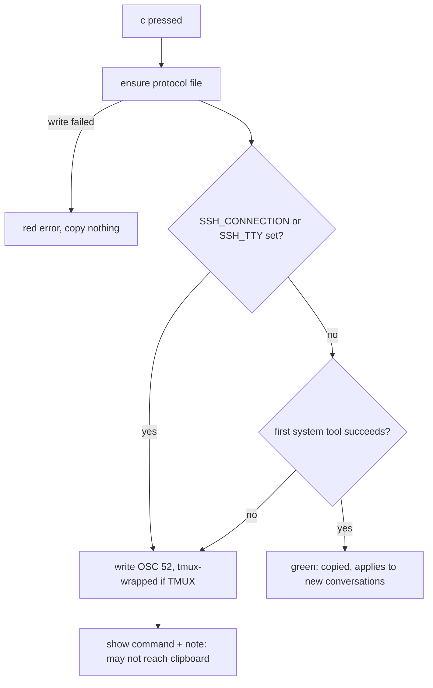
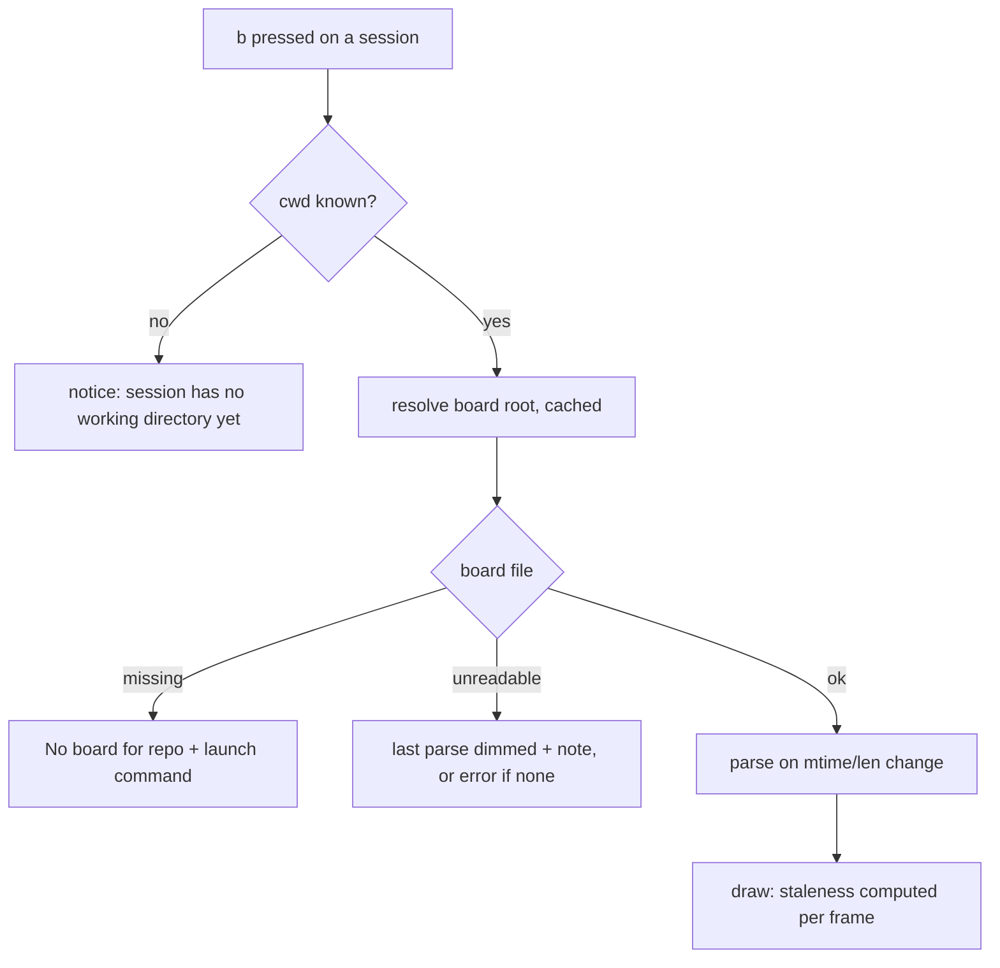

# Multi-Session Agent Coordination - Plan

## Goal Capsule

- **Objective:** Several Claude Code sessions working in the same repo know what each other are doing and avoid editing the same files. Users can start such a session with one paste and watch the coordination from the dashboard.
- **Product authority:** This plan covers group C of four. Status accuracy (A), the token counter (B), and badges and sharing (D) are separate plans and not active scope.
- **Open blockers:** None.

---

## Product Contract

### Summary

marsad ships a generic coordination protocol that sessions follow through a shared `AGENT-BOARD.md` at the repo root.
`c` in the dashboard copies a `claude --append-system-prompt-file <path>` command that loads the protocol into a new session's system prompt, so it survives `/clear` and compaction.
`b` opens a read-only view of the selected session's board.

### Problem Frame

The user often runs several sessions on one project, each on a different improvement. When two touch the same file they overwrite or conflict with each other.
They wrote a coordination protocol (`coordination-rules.md`) that solves this, but it has stack-specific examples, lives in their Downloads folder, and must be loaded into every session by hand. Instructions given in a prompt are lost on `/clear` and weakened by compaction.

### Requirements

**The protocol**

- R1. marsad bundles a coordination protocol derived from the user's `coordination-rules.md`: register on the board, claim files before editing, binding decisions, messages, conflicts, handoff notes, and keeping the board small.
- R2. The protocol is project-agnostic. Stack-specific examples become generic categories (lockfiles, dependency manifests, schemas, migrations, CI config, generated files), and nothing assumes a particular language, framework or branch name beyond "the default branch".
- R3. The protocol works in a repo with git worktrees (one board per repo) and degrades sensibly outside a git repo (board in the current directory).
- R4. `marsad install` writes the protocol to a stable path under marsad's data directory, and upgrading marsad refreshes it. `marsad uninstall` removes it.

**Launching sessions with it**

- R5. `c` in the dashboard copies `claude --append-system-prompt-file <absolute path>` to the clipboard, and the footer confirms it. The user does not need to know where the file lives.
- R6. When the clipboard cannot be reached, the dashboard shows the full command so the user can copy it by hand.
- R7. A `marsad coordination` command prints the same launch command and the protocol's path, for scripts and terminals without the dashboard.

**Board view**

- R8. `b` on a session opens a view of the `AGENT-BOARD.md` for that session's repo, showing agents with last-seen times, claims, decisions, messages, open conflicts and needs-human items.
- R9. Agents and claims whose last-seen time is over 2 hours old are shown as stale. Needs-human conflicts are highlighted.
- R10. The board view is read-only and refreshes while open. When the repo has no board, it says so and shows the launch command.

### Key Decisions

- **System prompt file, not CLAUDE.md.** Appending to the system prompt survives `/clear` and compaction and does not touch the user's repo files. Governs R5.
- **Show the board in the dashboard.** Users spot collisions without opening the file. (session-settled: user-directed — chosen over rules plus copy key only, and over conflict flags only.) Governs R8.
- **Its own view, not the details pane.** The details pane has room for about nine lines; a board needs more. Governs R8.
- **marsad never edits the board.** Sessions own it under the protocol. A second writer would break the protocol's one-line edit rules. Governs R10.
- **Over SSH, `c` copies through the terminal and shows the command.** A system clipboard tool on the remote machine fills the wrong clipboard, so marsad skips it, sends OSC 52, shows the command, and never claims it copied. (session-settled: user-directed — chosen over trying every method as locally, which can report "copied" with an empty local clipboard, and over only showing the command.) Governs R5, R6.

### Acceptance Examples

- AE1. **Covers R5, R6.** Given the dashboard is open on macOS, when the user presses `c`, then the clipboard holds the launch command and the footer says it was copied; over SSH where no clipboard is reachable, the footer shows the command itself.
- AE2. **Covers R3, R8.** Given two sessions in different worktrees of one repo, when the user presses `b` on either, then both show the same board from the main checkout.
- AE3. **Covers R9.** Given an agent whose last-seen time is 3 hours ago, when the board view opens, then that agent and its claims are marked stale.

### Scope Boundaries

- Editing, sweeping or resolving board entries from marsad.
- Enforcing claims (for example blocking edits through hooks).
- Coordination across machines.

### Dependencies / Assumptions

- `claude --append-system-prompt-file` works in Claude Code 2.1.309: a file's text reached the model in a `-p` run, and a missing file exits with `Append system prompt file not found`. Interactive sessions are assumed to behave the same.
- Claude Code records a conversation's system prompt on its first request and replays it on every resume until the conversation is compacted (`--system-prompt-snapshot`, on by default), so the protocol reaches new conversations only.
- Board entries follow the protocol's template, so the view can parse its sections and tables. Lines it cannot parse are still shown as text.

### Outstanding Questions

**Deferred to Planning**

- Clipboard mechanism per platform: resolved in KTD3.

### Sources / Research

- Source protocol: the user's `coordination-rules.md` (outside the repo; its content is to be bundled with the edits in R2).
- Bundled assets pattern: `assets/SKILL.md` is embedded and written by `install` in `src/install.rs`.

---

## Planning Contract

Product Contract preservation: unchanged in scope. Added one Key Decision (SSH clipboard, Governs R5, R6), refreshed two Dependencies facts from verification, and pointed the deferred clipboard question at KTD3.

### Key Technical Decisions

- KTD1. **The protocol ships as `assets/COORDINATION.md`, embedded with `include_str!`, and is written to `<data_dir>/coordination.md`.** The path comes from `crate::data_dir()` made absolute (no `canonicalize`, which yields `\\?\` paths on Windows). Writes go through a temp file and rename, and only when the content differs, so a launching `claude` never reads a torn file. Users who want changes copy the file elsewhere; marsad overwrites its own copy. Serves R1, R4.
- KTD2. **Every entry point refreshes the file: `install`, dashboard start, `c` and `marsad coordination`.** `marsad update` only swaps the binary and never re-runs `install` (`src/update.rs`), so without this a shell alias would keep an old protocol after upgrading. `install` warns and continues when the write fails. `c` and `marsad coordination` report an error and copy or print nothing, because a command pointing at a missing file is worse than none. `uninstall` removes only that file. Serves R4, R7.
- KTD3. **Clipboard order depends on where marsad runs.**
  - Locally: try the first system tool that exists (`pbcopy` on macOS; `wl-copy`, then `xclip -selection clipboard`, then `xsel --clipboard --input` on Linux; `clip.exe` on Windows and WSL). Each gets the command on stdin, null stdout and stderr, and a bounded wait of about one second. `xclip` and `wl-copy` fork, and a hung tool must not freeze the 250 ms UI loop. If a tool succeeds, the footer says "copied" and no OSC 52 is sent.
  - When every tool fails, or when `SSH_CONNECTION` or `SSH_TTY` is set, marsad writes OSC 52 (`ESC ] 52 ; c ; <base64> BEL`, plus the tmux DCS passthrough form when `TMUX` is set) and shows the command. OSC 52 has no acknowledgement, so it never earns "copied".
  - No new dependency: a small base64 encoder, tested against known vectors.
  - Serves R5, R6, governed by the SSH Key Decision.
- KTD4. **The copied command quotes the path for the platform's shell.** It is bare when every character is in `[A-Za-z0-9_./:@%+=,-]`. Otherwise it is single-quoted with `'\''` escapes on Unix and double-quoted on Windows. It never contains `~` and never ends in a newline. Serves R5, R7.
- KTD5. **The board root uses the same rule the protocol gives agents.** marsad runs `git -C <cwd> rev-parse --git-common-dir` (no `--path-format`, which git before 2.31 echoes back; a relative answer is joined onto the cwd and anything but one path line is rejected), with `GIT_DIR` and `GIT_WORK_TREE` removed from the child's environment, and takes its parent directory when the common dir is named `.git`; otherwise (a bare clone, a submodule) the board goes inside the common dir, so repos sharing a parent folder never share a board (session-settled: user-directed — chosen over keeping the parent rule everywhere, and over the main worktree's top level). Outside git it uses the session's cwd. When the cwd no longer exists, marsad walks up to the nearest existing ancestor and retries once. An empty `Session.cwd` (no event yet) never falls back to marsad's own working directory. The result is cached per session cwd: a git result until the cwd changes, a non-git result for about 30 s. git runs once per `b` press or cache expiry, never per tick. Serves R3, R8, AE2.
- KTD6. **The board parser is lenient and pure.**
  - It reads at most 512 KB, decoded as lossy UTF-8.
  - It strips `<!-- -->` comments first, because the template's placeholders live in comments and the Conflicts placeholder contains `needs-human`.
  - It splits on `## ` headings and maps table columns by header name.
  - A conflict's status is its last `|` segment, so a message that only mentions needs-human does not match.
  - Lines it cannot place stay as text under their section.
  - Serves R8, R9.
- KTD7. **Staleness is computed at draw time from the stored parse.** A last-seen value is parsed as local `YYYY-MM-DD HH:MM`. It is stale when more than 2 hours old. Unparseable or future times are shown as written and not marked. A claim is stale when its owner's agent row is stale or missing ("orphan"). The file is re-read only when its (mtime, length) changes. A read error keeps the last good parse, shown dimmed. An unchanged file still turns stale as time passes. Serves R9, R10, AE3.
- KTD8. **The board view is repo-wide.** Board names (`agent-…`) can't be joined to marsad sessions, so the view's title names the repo and board path rather than the session. The view says that only sessions started with the coordination prompt register. Serves R8.
- KTD9. **The bundled protocol adapts the user's text for R2 and for Claude Code's tools.** The section structure and board template stay. The changes:
  - Generic terms: "the default branch", and "lockfiles, dependency manifests, schemas, migrations, CI config, generated files".
  - Board path: a resolver that handles the non-git case with an absolute starting directory.
  - Exclude entry: written to `<git-common-dir>/info/exclude`, and skipped outside git.
  - No `BOARD =` override line, because marsad overwrites the file and the dashboard could not follow it.
  - Waits: `sleep 60` re-checks, since the Bash tool's default timeout is 2 minutes.
  - Edits: use the Edit tool with a unique anchor line, never rewrite the file.
  - Subagents: the prompt doesn't reach them, so their prompts carry the board path, the agent name and the claimed paths.
  - Precedence: the user's direct instructions win over the protocol.
  - Serves R1, R2, R3.
- KTD10. **`marsad coordination` prints the command on a line of its own, then the protocol path.** `--format json` gives `{command, protocol_path}`. Agents find the board through the protocol's own resolver, so the CLI doesn't need git. Serves R7.

### High-Level Technical Design

### Assumptions

- `b` works from the session list and from the per-session History and Agents views; `c` works from the list (including an empty one) and from the board's "no board" screen.
- A command too wide for the terminal is shown as the flag on one line and the quoted path on the next, with a pointer to `marsad coordination`, because a hard-wrapped command would not paste cleanly.
- The protocol adds roughly 1.5-2k tokens to every request of a session that loads it; the README says so.
- Exact helper names and module boundaries are the implementer's call; the pure pieces (quoting, OSC 52 bytes, clipboard step selection from an injected environment, board root with an injected git runner, comment stripping, parsing, staleness) stay out of `src/app.rs` and `src/ui.rs`, which have no render tests.

### Risks & Dependencies

- `--append-system-prompt-file` has no help line of its own in 2.1.309; if a later Claude Code drops it, launches fail loudly with "file not found"-style errors rather than silently. Re-check on Claude Code upgrades.
- Whether compaction of a resumed conversation picks up a newly passed prompt file is unverified, so all user-facing text says "new conversations only".
- OSC 52 is ignored by Terminal.app, off by default in iTerm2, and needs `allow-passthrough` or `set-clipboard on` in tmux; showing the command covers every case.

---

## Implementation Units

### U1. Bundled protocol and its file

- **Goal:** marsad carries the adapted protocol and can write, refresh and remove its copy, and build the launch command.
- **Requirements:** R1, R2, R3, R4; KTD1, KTD4, KTD9.
- **Dependencies:** none.
- **Files:** `assets/COORDINATION.md` (new), `src/coordination.rs` (new, with tests), `src/main.rs` (module).
- **Approach:**
  1. Write `assets/COORDINATION.md` from the user's source with the KTD9 edits, keeping its sections 1-9 and the board template.
  2. In `src/coordination.rs`, add the protocol path, a compare-then-temp-and-rename writer, a remover that deletes only that file, the platform quoting function, and the launch command builder.
- **Patterns to follow:** `SKILL_MD` and `skill_dir` in `src/install.rs`; temp-dir tests built from `std::env::temp_dir()` plus the process id.
- **Test scenarios:**
  - A fresh directory gets the file with the embedded content, and a second call leaves its mtime unchanged.
  - A file with different content is replaced, and no temp file remains.
  - Removal deletes only `coordination.md`, leaving other files in the data dir.
  - Quoting: a plain path stays bare, a path with a space is single-quoted, a path with `'` is escaped as `'\''`, and a Windows path with a space is double-quoted.
  - The command is `claude --append-system-prompt-file <quoted path>` with no trailing newline.
  - The embedded protocol contains no `Prisma`, `package.json`, `sleep 300` or `BOARD =`, and does contain the board template headings.
- **Verification:** the protocol reads as project-agnostic, and the file round-trips through write, refresh and remove.

### U2. Entry points: install, uninstall, dashboard start, `marsad coordination`

- **Goal:** The protocol file exists and matches the running binary wherever the user meets it.
- **Requirements:** R4, R7; KTD2, KTD10.
- **Dependencies:** U1.
- **Files:** `src/install.rs`, `src/main.rs`, `src/app.rs`, `src/coordination.rs` (tests).
- **Approach:**
  1. `install` writes the file after the skill and prints its path. A failure prints a warning and the install still completes.
  2. `uninstall` removes the file.
  3. `App::new` refreshes it silently.
  4. A new `Coordination` subcommand with `--format table|json` prints per KTD10, exiting non-zero on a write failure.
- **Patterns to follow:** the `Context(context::ContextArgs)` subcommand and `Format` enum in `src/main.rs`/`src/report.rs`.
- **Test scenarios:**
  - The JSON output has `command` and `protocol_path`, and `protocol_path` exists afterwards.
  - Table output puts the command alone on its first line.
  - An unwritable data dir makes the coordination command return an error.
- **Verification:** `marsad coordination` prints a command that launches a session which can name the protocol's board rules; `install` then `uninstall` leaves no `coordination.md`.

### U3. Clipboard

- **Goal:** One call copies text, picking the method per KTD3 and reporting copied, terminal-only or failed.
- **Requirements:** R5, R6; KTD3.
- **Dependencies:** none.
- **Files:** `src/clipboard.rs` (new, with tests), `src/main.rs` (module).
- **Approach:**
  1. Choose the steps from an injected environment and platform.
  2. Run the native tools with piped stdin, null output and a bounded wait, killing a tool that overruns.
  3. Build the OSC 52 bytes, plus the tmux wrapping.
  4. Write them to stdout and flush.
- **Patterns to follow:** `alerts::spawn` (missing-program handling) and the raw bell write in `alerts::play`.
- **Test scenarios:**
  - Base64 of `""`, `f`, `fo`, `foo` and `foobar` match RFC 4648 vectors.
  - OSC 52 for `foo` is `ESC]52;c;Zm9v BEL`.
  - With `TMUX` set, the sequence is wrapped in `ESC Ptmux;` with doubled inner escapes and ends with `ESC \`.
  - With `SSH_TTY` set, the plan contains no native tool and ends in OSC 52 plus "show".
  - On Linux without SSH, the plan tries `wl-copy`, then `xclip`, then `xsel`.
  - A tool that exits non-zero moves on to the next tool.
- **Verification:** on the developer's Mac, the text lands in the clipboard via `pbcopy`. With `SSH_TTY=x` set, the result is terminal-only.

### U4. `c` key and the command notice

- **Goal:** `c` refreshes the protocol, copies the command, and tells the user what happened.
- **Requirements:** R5, R6, AE1; KTD2, KTD3.
- **Dependencies:** U1, U3.
- **Files:** `src/app.rs`, `src/ui.rs`.
- **Approach:**
  1. Add an info notice next to `app.error`, with precedence error > notice > update.
  2. The notice clears on a keypress, not on the refresh tick.
  3. "copied" shows green with "applies to new conversations".
  4. Terminal-only and failed results show a borderless block above the footer: the command on its own line, then "or run `marsad coordination`". When the command is wider than the terminal, show `claude --append-system-prompt-file` on one line and the quoted path on the next, so each piece copies cleanly.
  5. Add `c`, and `b` from U6, to the key hints, and the `c` hint to the empty-list screen.
- **Patterns to follow:** `app.error` handling and `draw_empty`, and the hint arms in `src/ui.rs`.
- **Test scenarios:**
  - Test expectation: none for rendering (no ui test harness).
  - Covered through U3's step selection and U1's command builder.
  - Checked by the smoke run in the Verification Contract.
- **Verification:** on macOS, pressing `c` shows the green notice and the clipboard holds the command. With `SSH_TTY=x marsad`, the command block appears and no "copied" text is shown.

### U5. Board model

- **Goal:** From a session's cwd, find the board and turn its text into agents, claims, decisions, messages, conflicts and handoff notes with staleness.
- **Requirements:** R3, R8, R9, AE2, AE3; KTD5, KTD6, KTD7.
- **Dependencies:** none.
- **Files:** `src/board.rs` (new, with tests), `src/main.rs` (module).
- **Approach:**
  1. Resolve the root with an injectable git runner and the KTD5 fallbacks.
  2. Read with the size cap.
  3. Strip comments, split sections and map tables by header.
  4. Classify against a passed-in `now`.
- **Patterns to follow:** pure functions with explicit paths and times, like `store::periods(conn, today)`; tests that run `git init` and `git worktree add` in temp dirs, skipped when `git` is missing.
- **Test scenarios:**
  - Covers AE2: two worktrees of one repo resolve to the same board path in the main checkout.
  - A plain checkout resolves to its root.
  - A non-git dir resolves to the dir itself.
  - A deleted worktree dir walks up and still resolves.
  - An empty cwd yields "no working directory", not a path.
  - The fresh template board has zero agents, zero conflicts and zero needs-human.
  - A board with one `| needs-human` conflict has exactly one, and a message mentioning needs-human adds none.
  - A table with an extra column still maps `agent` and `last seen` by header.
  - Covers AE3: last-seen 121 minutes ago is stale, 119 is not, and exactly 120 is not.
  - A future time and a garbage time are not stale.
  - A claim whose agent has no row is an orphan and counts as stale.
  - A 2 MB file is truncated to the cap with a note.
- **Verification:** all scenarios pass, and parsing the user's real template text yields an empty board.

### U6. Board view

- **Goal:** `b` opens a read-only, live view of the session's repo board.
- **Requirements:** R8, R9, R10; KTD7, KTD8.
- **Dependencies:** U5, U4 (notice).
- **Files:** `src/app.rs`, `src/ui.rs`, `src/board.rs`.
- **Approach:**
  1. Add a unit `View::Board` variant (`View` derives `Copy`) and keep the board state (resolved path, last good parse, (mtime, len) key) in an `App.board` field, as `View::Usage` keeps its state in `App.usage`.
  2. Re-read on change during the slow refresh.
  3. Re-resolve when the session's cwd changes.
  4. Draw the sections in protocol order, each with a header line and a count, and `(none)` when empty. Rows: agents as name, task, last seen; claims as path, agent, since; conflicts as text and status; decisions, messages and handoff notes as their line. Long text wraps under its row, indented. Stale agents and claims get a `[stale]` suffix and are dimmed; needs-human conflicts get a leading `NEEDS HUMAN` tag in yellow, so neither state depends on color alone.
  5. Missing board: show the launch command and the `c` hint.
  6. Unreadable board: per KTD7, show a distinct read-error message only when no good parse exists yet; otherwise keep the last parse dimmed with a one-line read-error note.
  7. Keys: `↑↓`/`g`/`G` scroll, `esc` or `b` back to the list, `c` copies.
- **Patterns to follow:** `View::Usage` and `src/usage.rs` (own state, `tick`/`reload`/`on_key`), and the scrolling in the History view.
- **Test scenarios:**
  - Test expectation: none for rendering.
  - Behavior is covered in U5.
  - Checked by the smoke run.
- **Verification:** with two sessions in two worktrees of one repo, `b` on either shows the same board. Editing the board in another terminal updates the view within a couple of seconds.

### U7. Documentation

- **Goal:** README, CHANGELOG and the bundled skill describe coordination.
- **Requirements:** R1-R10.
- **Dependencies:** U1-U6.
- **Files:** `README.md`, `CHANGELOG.md`, `assets/SKILL.md`.
- **Approach:**
  1. README: a Coordination section covering what the protocol does, `c`, `b`, `marsad coordination`, "new conversations only", the SSH and tmux clipboard note, and the token cost. Add `c` and `b` to the keys line, and the protocol file to the install/uninstall comments.
  2. CHANGELOG: two or three bullets under `## Unreleased`.
  3. `assets/SKILL.md`: `marsad coordination --format json` and where the board lives.
- **Test scenarios:** Test expectation: none -- documentation.
- **Verification:** every key and command in the code appears in README, and the CHANGELOG bullets are one line each.

---

## Verification Contract

| Gate | Command or check | When |
|---|---|---|
| Unit tests | `cargo test --locked` | every unit |
| Lints | `cargo clippy --all-targets -- -D warnings` | every unit |
| Formatting | never run `cargo fmt`; match surrounding style by hand | every unit |
| Smoke: protocol | `MARSAD_HOME=<scratch> marsad coordination`, then launch the printed command with `-p` and ask where the board lives | after U2 |
| Smoke: clipboard | dashboard on macOS, press `c`, paste; then `SSH_TTY=x` and press `c` again | after U4 |
| Smoke: board | two worktrees of a scratch repo, a hand-written board with a 3-hour-old agent and a needs-human conflict, `b` on each session | after U6 |

Never point a smoke test at the real `~/.claude/marsad` for writes; use `MARSAD_HOME` with a scratch dir.

---

## Definition of Done

- Every R1-R10 and AE1-AE3 is met, and the U1, U3 and U5 test scenarios pass.
- `cargo test --locked` and `cargo clippy --all-targets -- -D warnings` are clean.
- README, CHANGELOG (`## Unreleased`) and `assets/SKILL.md` describe `c`, `b` and `marsad coordination`.
- The three smoke checks above were run and their results noted in the PR.
- No leftover experimental code, temp files or unused helpers in the diff.
