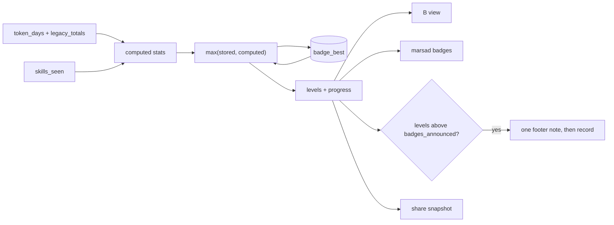
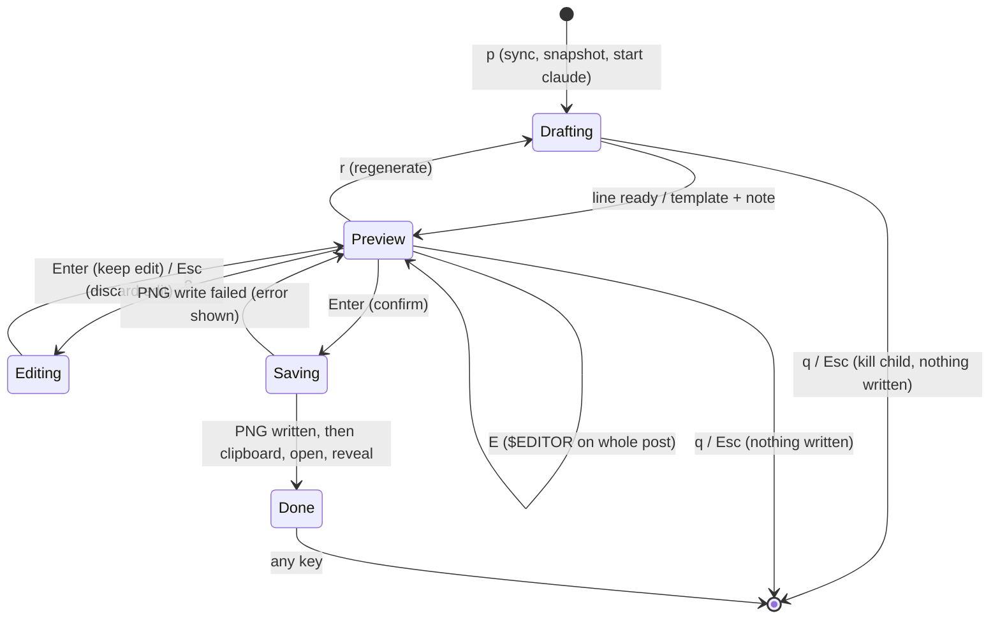

# Badges and LinkedIn Share - Plan

## Goal Capsule

- **Objective:** Users can show recruiters and clients credible evidence of their AI fluency: a rank and achievements earned from their real Claude Code usage, shared to LinkedIn as a polished post with an attractive badge card, in a few keystrokes.
- **Means:** badges computed from marsad's permanent counters and stored high-water marks (KTD3, KTD4), a generated SVG badge rendered to PNG in-process (KTD6, KTD7), and a reviewed share flow that drafts its line with `claude -p` (KTD8-KTD12).
- **Product authority:** This plan covers group D of four. It depends on the permanent token counter from group B (`docs/plans/2026-10-23-0715-feat-token-counter-and-data-plan.md`, R6) and stacks on group C (branch `feat/agent-coordination`, PR #22). Status accuracy (A) and agent coordination (C) are not active scope.
- **Stop conditions:** Stop and ask when the rendered sample card is ready for review (Success Criteria), or when evidence shows a Product Contract rule cannot be met.
- **Execution profile:** one branch (`feat/badges-and-share`), one stacked PR, units landed as separate commits.
- **Open blockers:** None.

---

## Product Contract

### Summary

marsad awards a rank from all-time tokens and bronze, silver and gold achievements from local usage numbers, and shows them in a badge view.
A share key drafts a short, professional AI-fluency line from today's work, lets the user review and edit the post, saves a PNG card with an Islamic geometric badge and token stats, and opens LinkedIn with the text filled in.

### Problem Frame

The user wants recruiters and business owners to judge their AI skills from evidence, not claims. marsad already knows how much they use Claude Code and which skills and agents they use, but none of it can be shown to anyone outside the terminal.
A bare token count reads as volume. A rank, a few achievements and one sentence about the kind of work done read as fluency.

### Requirements

**Badges**

- R1. marsad assigns one rank from the user's all-time token total, across 7 tiers from Novice to Grandmaster, each with a name and threshold.
- R2. marsad awards achievements, each with bronze, silver and gold levels: longest streak of active days, distinct skills used, subagents run, and busiest single day.
- R3. Ranks and achievements are computed only from local marsad data, recalculate as usage grows, and are never revoked when detail history is pruned.
- R4. `B` in the dashboard opens a badge view: the current rank with progress to the next, each achievement's level and progress, and the stats behind them.
- R5. A rank-up or new achievement level is announced once in the dashboard footer.

**Badge visual design**

- R6. Each rank's badge uses Islamic geometric design: a star-and-polygon pattern built on a circle (for example an 8- or 12-point star with girih-style interlace), with the pattern's complexity and color growing with the tier.
- R7. Badges have no figurative imagery and no religious text, so they suit a professional audience.

**Share**

- R8. The share key, available from the badge view and the main list, prepares a LinkedIn post with today's tokens, the last 7 and 30 days, all-time tokens, per-day average, the rank, and a 1–3 sentence AI-fluency line.
- R9. The AI-fluency line is generated by running Claude Code headless over a summary of today's work (session titles with project names removed, skills, subagent types, token figures). It is professional, first person, aimed at recruiters and business owners, and names no projects, clients or companies.
- R10. Before anything is saved, copied or opened, the user sees the full post text, can edit or regenerate the line (or edit the whole post), and confirms or cancels. The redacted work summary of R9 is the only thing sent anywhere before that.
- R11. On confirm, marsad saves a 1200×627 PNG card showing the badge, rank, and token stats, puts the post text on the clipboard, opens LinkedIn's post composer with the text filled in where LinkedIn allows it, and reveals the PNG in the file manager so the user can attach it.
- R12. When Claude Code cannot be run or fails, the post uses a template line built from the stats, and says so in the preview.
- R13. `marsad share --print` prints the post text and writes the card without opening a browser, for terminals without a desktop.

### Key Decisions

- **Token tiers plus achievements.** Tiers are easy for a recruiter to read; achievements reward breadth (skills, agents, streaks) and not just volume. (session-settled: user-approved — chosen over token tiers only, and over AI-judged work quality, which is slow, costs tokens and is not reproducible.) Governs R1, R2.
- **Craft-ladder tier names: Novice, Apprentice, Practitioner, Specialist, Expert, Master, Grandmaster.** They read instantly to a recruiter. (session-settled: user-directed — chosen over geometric names (Point to Girih), which need explaining, and over showing both.) Governs R1.
- **Rank counts all tokens, cache reads included.** The badge, the post and the dashboard header show the same number. (session-settled: user-directed — chosen over excluding cache reads, which shrinks the numbers about 25× and disagrees with the header.) Governs R1, R8.
- **`p` opens Share from the list.** (session-settled: user-directed — chosen over sharing only from the badge view, and over `L`, which names one network.) Governs R8.
- **PNG card plus prefilled post.** LinkedIn's share link can prefill text but cannot attach an image. (session-settled: user-approved — chosen over a hosted badge page, which publishes the stats on the web, and over text-only.) Governs R11.
- **Nothing is shared without review.** The line comes from a model and may misdescribe the work. Governs R10.
- **The model never sees or names clients.** Project and folder names never leave the machine; titles go out with them stripped, and the reply is checked for them. (session-settled: user-directed — chosen over sending no titles, which makes the line generic, and over confirming the payload on every share.) Governs R9, R10.
- **Edit the line inline, or the whole post with `E`.** (session-settled: user-directed — chosen over editing the AI line only, and over a multi-line editor inside marsad.) Governs R10.
- **The card goes to the Downloads folder.** It is easy to drag into LinkedIn from there. (session-settled: user-directed — chosen over marsad's hidden data dir, and over the current directory.) Governs R11.

### Key Flows

- F1. Share today's work
  - **Trigger:** The user presses the share key.
  - **Steps:** marsad gathers today's stats and work summary, generates the line (with a progress indicator), shows the post preview, the user edits or regenerates, then confirms. marsad saves the card, copies the text, opens LinkedIn and reveals the card.
  - **Outcome:** A LinkedIn composer with the post text ready and the card one drag away.
  - **Covered by:** R8, R9, R10, R11

### Acceptance Examples

- AE1. **Covers R3.** Given the user earned the silver streak achievement 40 days ago, when retention pruning removes those days' detail, then the achievement stays silver.
- AE2. **Covers R10.** Given the preview is open, when the user cancels, then no file is written and no browser opens.
- AE3. **Covers R12.** Given `claude` is not on PATH, when the user shares, then the preview shows a template line and a note that it was not generated.
- AE4. **Covers R9.** Given a session in project `acme-portal` today titled "Acme Corp invoice parser", when the line is generated, then it does not contain "Acme".

### Success Criteria

- The card looks good enough that the user would post it. A rendered sample is reviewed with the user before the design is finalized.

### Scope Boundaries

- Posting through LinkedIn's API or any account login.
- Other networks (X, Mastodon); the post and card are written so they can be added later.
- Public profile pages or hosted badges.
- AI-judged quality badges.

### Dependencies / Assumptions

- Group B's permanent token counter provides today, 7-day, 30-day and all-time totals and averages (`store::periods`).
- LinkedIn's `feed/?shareActive=true&text=` link is undocumented and works on desktop web only, so the clipboard copy in R11 is the guarantee and the prefill is best effort.
- Streaks and busiest day come from the permanent counter; distinct skills need a running total that survives pruning (KTD3).

### Outstanding Questions

None. Tier names and thresholds, the list key and the PNG renderer were resolved in planning (Key Decisions, KTD1, KTD7).

---

## Planning Contract

Product Contract preservation: changed R9, R10 and R11, and added Key Decisions. R9 now names the redacted titles, and R10 now says the redacted summary is the only thing sent before review, both from the user's privacy choice; R10 also gains whole-post editing. R11 adds the clipboard copy and marks the prefill as best effort, after research found the prefill link undocumented. Six session-settled Key Decisions were added (tier names, token count, `p`, privacy, editing, card folder), and Outstanding Questions were resolved. R1 now names its end tiers and AE4 names its project, both to match those decisions.

### Key Technical Decisions

- KTD1. **Thresholds are constants in one table.** Tiers: Novice 0, Apprentice 1M, Practitioner 10M, Specialist 50M, Expert 250M, Master 1B, Grandmaster 5B tokens. Achievements (bronze/silver/gold): longest streak 3/7/30 active days, distinct skills 3/10/25, subagents run 10/100/1000, busiest day 10M/50M/200M tokens. One table drives the levels, the progress bars, `marsad badges` and the docs, so retuning is a one-line change. Serves R1, R2.
- KTD2. **The rank figure is the header's all-time figure.** In the dashboard that is `app.counter.totals()`, which includes live usage not yet indexed; the CLI uses `store::lifetime`. Serves R1, R8, governed by the token-count Key Decision.
- KTD3. **Every badge stat has a permanent source.**
  - Rank: `token_days` plus `legacy_totals`.
  - Longest streak and busiest day: the per-day rows of `token_days`. Days hidden inside a pre-0.4 `legacy_totals` range are not visible; this is accepted.
  - Subagents run: distinct (session, agent) pairs in `token_days` whose agent is not the main agent.
  - Distinct skills: a new never-pruned `skills_seen` table keyed by skill, filled in `write_unit` with an upsert that keeps the earliest day, so re-reading a transcript never double counts. A `SCHEMA_VERSION` 2 migration backfills it from `skill_runs` and reuses the existing "re-read every transcript once" step. Skills already pruned whose transcripts are gone are lost once; the CHANGELOG says so.
  - Serves R2, R3.
- KTD4. **Best values are stored and never go down.** A `badge_best` table (stat key, value) keeps the highest value ever computed for the rank total and each achievement. Shown value = max(stored, computed), and levels come from the shown value, so pruning or a lower restore import never revokes or shrinks anything. Both new tables join `portable.rs` export with MAX merges (MIN for `first_day`). The best values are written on the sync connection after each sync, never from the draw path. Serves R3, AE1.
- KTD5. **Announcements are per machine, in settings.json.** `badges_announced` maps each stat to its last announced level. When the key is missing (upgrade, new install, corrupt file) marsad seeds it silently with the current levels. When levels rise it shows one combined green footer note ("rank up: Expert · new: gold streak") and records it. The note shows only on the list and badge views (held while the share view is open), stays for 10 seconds or until Esc instead of clearing on the next key, and the levels are recorded once it has been drawn. Not in `PORTABLE`. Serves R5.
- KTD6. **The badge art is one deterministic geometry module.** It builds the star with the Hankin method on a regular n-gon: rays at a contact angle from each edge midpoint, intersected with the neighbours' rays. The output is line segments plus fills. Tiers add complexity: 8-point star for the low tiers; 12-point with an inner rosette and an outer ring in the middle tiers; 16-point double interlace for the top tiers. The palette moves from slate and teal through lapis to gold. Strapwork comes from a wide stroke under a narrow stroke. The same segments feed the SVG for the card and a ratatui `Canvas` in the badge view. No RNG, no text in the art. Serves R6, R7.
- KTD7. **The card is an SVG string rasterized by `resvg` with a bundled font.** `resvg` 0.48 runs with default features off and the `text` feature on. A static OFL font (Inter Regular and SemiBold, Latin subset) is loaded from `include_bytes!` into the font database, and system fonts are never read, so output is identical on macOS, Linux and Windows. It renders a 1200×627 `tiny-skia` pixmap encoded as PNG. This adds about 1-2 MB to the release binary. The font's OFL text ships in `assets/fonts/`. Chosen over shelling out to `rsvg-convert` or ImageMagick, which are missing on Windows and most Macs, and over `tiny-skia` with hand-laid text. Serves R11, R13.
- KTD8. **The line comes from one fresh, isolated `claude -p` call.**
  - Flags: `--safe-mode` (no hooks, CLAUDE.md, plugins or MCP; auth still works), `--no-session-persistence` (no transcript, so no ghost session in marsad and no extra tokens counted), `--tools ""` (no tools, so the reply is a single turn), `--model haiku`, `--output-format json`, plus a fixed `--system-prompt`. The summary goes in on stdin, and the cwd is a fresh temp dir. Every flag is in `claude --help` for 2.1.309; `--max-turns` is not, so it is not used.
  - `--bare` is not used: it needs an API key and fails for subscription logins.
  - Never resume or continue a conversation; see `docs/solutions/integration-issues/claude-code-system-prompt-snapshot-pins-coordination-protocol-to-new-conversations.md`.
  - It runs on a worker thread with a 60 s deadline and a shared cancel flag; on deadline or cancel the child is killed.
  - A missing binary, non-zero exit, `is_error` in the JSON, empty text or an unknown-option error (older Claude Code) falls back to the template line. Each case has its own note, so "your Claude Code is too old" is not shown as "claude failed". marsad never retries without the isolation flags.
  - Serves R9, R12.
- KTD9. **Redaction and post-check happen in marsad, not in the prompt alone.**
  - The summary holds today's titles, skills with counts, subagent types with counts, and the period figures.
  - The name list is each of today's sessions' project name plus its cwd path components below the user's home directory (never the home directory or its ancestors, so `Users` or `Projects` never count). Each name is also split into word tokens on `-`, `_`, `.`, spaces and camelCase boundaries; tokens shorter than 3 characters are ignored.
  - Every name and token is stripped from titles, skill names and subagent type names as a whole word, case-insensitively, before sending. A skill or agent name left empty is dropped. The project and cwd fields themselves are never sent.
  - The reply is rejected if it contains any name or token from the same list as a whole word, and the template is used with a note.
  - A client named only inside a title, matching no project or folder name, is not caught; the user's review (R10) covers it, and the README says so.
  - The system prompt asks for 1-3 first-person sentences for recruiters, with no names of projects, clients or companies, and no hashtags or emoji.
  - Serves R9, R10, AE4.
- KTD10. **One stats snapshot per share.** At `p` (or `marsad share`) marsad syncs, then freezes today, 7d, 30d, all-time, per-day average and rank. The text, the card and the file name use that snapshot, so they always agree. Serves R8, R11.
- KTD11. **The share view is a self-contained state machine matched before the global keys.** The share keys are handled before `q` quits and before notes are cleared (app.rs key loop). `q` and Esc cancel the share, kill any running child, and write nothing. Inline editing covers the line: Enter keeps the edit, Esc discards it and restores the previous line, and neither cancels the share. Bracketed paste is enabled so a pasted newline doesn't end the edit. `E` suspends the TUI and opens the whole post in `$VISUAL`/`$EDITOR`, falling back to `vi` or `notepad`, then restores it. Results go to a Done screen that stays until dismissed, not to `info`, which the next key clears. Serves R10, AE2.
- KTD12. **Confirm runs in a fixed order, and each step reports what happened.**
  1. Write the PNG to `dirs::download_dir()` as `marsad-YYYY-MM-DD.png` (fallback: `<data_dir>/cards/`). A same-day re-share overwrites it. If the write fails, stay in the preview with the error, and copy or open nothing.
  2. Copy the post text with `clipboard::copy`.
  3. Open `https://www.linkedin.com/feed/?shareActive=true&text=<percent-encoded>`, or the plain feed when the URL would exceed 2000 characters.
  4. Reveal the PNG: `open -R` on macOS, `explorer /select,` on Windows; on Linux, the FileManager1 `ShowItems` D-Bus call via `dbus-send`, else `xdg-open` on the folder.
  - Over SSH or with no display, steps 3 and 4 are skipped, and the Done screen shows the URL and the path.
  - Opening and revealing spawn detached OS tools. On Windows, URLs never go through `cmd /C start`, which splits on `&`.
  - Serves R11.
- KTD13. **`marsad share --print` and `marsad badges` reuse the same core.** `marsad share --print [--out <path>] [--no-ai]` syncs, snapshots, drafts the line (or the template), prints the post and writes the card, opening nothing. `marsad badges [--format table|json|csv]` prints rank, levels and progress, so agents get what the `B` view shows. Serves R4, R13.

### High-Level Technical Design

Where badge numbers come from and where they go:

The share view's states:

### Assumptions

- `--safe-mode` and `--no-session-persistence` exist in the installed Claude Code 2.1.309. Older versions get the template with a "Claude Code is too old" note (KTD8).
- The badge view draws the star with ratatui's `Canvas` in Braille; a coarse but recognisable shape is enough in the terminal, and the card carries the full design.
- Post shape, editable by the user: the line, a blank line, then "Today X tokens · last 7 days Y · last 30 days Z (W/day)", then "All-time T tokens · Rank: <tier>". Numbers are abbreviated (`197M`, `1.2B`) as in the header.
- Sharing on a day with no usage is allowed; the template says so plainly.

### Risks & Dependencies

- LinkedIn may drop the `shareActive` prefill at any time. The clipboard copy and the Done screen's "paste if the box is empty" line cover it, and the URL builder is one pure function.
- `resvg` adds compile time and 1-2 MB of binary. If size matters later, the PNG path could move behind a cargo feature.
- Model output can drift from the rules. The post-check (KTD9) and the user's review (R10) are the safeguards; the prompt is not trusted alone.
- The `SCHEMA_VERSION` 2 migration re-reads every transcript on disk once, so the first sync after the upgrade is slower, as with group B.

### Sources / Research

- Store tables and what survives pruning: `src/store.rs` (`SCHEMA`, `prepare`, `write_unit`, `prune`, `lifetime`, `days`, `periods`), `src/portable.rs` (`TABLES`), `src/settings.rs`.
- Background work and subprocess patterns: `Usage::start_sync`/`tick` in `src/usage.rs`, `clipboard::run_tool` deadline-and-kill in `src/clipboard.rs`, detached spawn in `src/alerts.rs`.
- `claude -p` flags: `claude --help` (2.1.309) for `--safe-mode`, `--no-session-persistence`, `--tools`, `--bare`.
- LinkedIn prefill behaviour and limits: community reports on `feed/?shareActive=true&text=`; the post composer takes up to 3000 characters (LinkedIn Help).
- Star construction: Craig S. Kaplan, "Islamic Star Patterns from Polygons in Contact" (Graphics Interface 2005), after E. H. Hankin (1925).
- `resvg` 0.48.1 / `tiny-skia` 0.12 (MIT/Apache-2.0, BSD-3-Clause); `usvg` text stack fontdb 0.24.

---

## Implementation Units

### U1. Permanent stores for skills and best values

- **Goal:** Distinct skills and badge best values survive pruning, re-reads and machine moves.
- **Requirements:** R2, R3, AE1; KTD3, KTD4.
- **Dependencies:** none.
- **Files:** `src/store.rs`, `src/portable.rs`, `assets/SKILL.md` (schema section).
- **Approach:**
  1. Add `skills_seen (skill PK, first_day)` and `badge_best (key PK, value)` to `SCHEMA`, with in-SQL comments as for `token_days`.
  2. Bump `SCHEMA_VERSION` to 2 and make the migration stepwise: the existing steps run only when the stored version is below 1, and the v2 steps (backfill `skills_seen` from `skill_runs`, clear `files` so transcripts are re-read once) run when it is below 2. Re-running the v1 copy on a v1 database would double count legacy-range days.
  3. Upsert `skills_seen` in `write_unit` for every skill run with a known day, before the retention-cutoff check that filters `skill_runs`, and outside the per-unit deletes. Otherwise the re-read recovers no skill older than retention.
  4. Add a small read/raise API for `badge_best` (read all; raise one key to max(old, new)).
  5. Add both tables to `portable.rs` `TABLES` with MAX and MIN merges.
- **Patterns to follow:** the version-1 migration in `prepare`; `token_days` upserts; `portable.rs` merge clauses.
- **Test scenarios:**
  - A v1 database migrates to v2, `skills_seen` holds every skill from `skill_runs` with its earliest day, and `files` is emptied.
  - Re-indexing the same transcript twice leaves `skills_seen` unchanged.
  - A transcript with a skill run older than the retention cutoff adds that skill to `skills_seen` but not to `skill_runs`.
  - Migrating a v1 database with retention set to forever and `usage_daily` rows inside a legacy range leaves `token_days` unchanged.
  - Pruning `skill_runs` past retention leaves `skills_seen` intact.
  - Raising a best value to a lower number keeps the old value; to a higher one replaces it.
  - Export then import into a database with higher best values keeps the higher ones; `first_day` keeps the earlier day.
  - Importing an export from before v2 reports the two tables as missing and still imports the rest.
- **Verification:** The new tables appear in `marsad schema` output and in an export file, and the migration test passes.

### U2. Badge model and `marsad badges`

- **Goal:** One function turns the store into rank, achievement levels and progress, never lower than before.
- **Requirements:** R1, R2, R3, R4 (data), R5 (diff), AE1; KTD1, KTD2, KTD3, KTD4, KTD5, KTD13.
- **Dependencies:** U1.
- **Files:** `src/badges.rs` (new), `src/main.rs`, `src/settings.rs`, `src/store.rs` (stat queries if not already present).
- **Approach:**
  1. Constants for tiers and achievements (KTD1).
  2. Compute each stat from its permanent source (KTD3), then raise and read `badge_best` (KTD4) on the sync connection.
  3. Levels and progress to the next threshold come from the shown values.
  4. An announcement diff against `badges_announced` that seeds silently when the key is missing (KTD5).
  5. `marsad badges --format table|json|csv` prints the same data.
- **Patterns to follow:** `report::Format` and `--no-sync` handling in `src/report.rs`; `settings::*_at(path)` for testable settings.
- **Test scenarios:**
  - Covers AE1. A silver streak recorded as a best value stays silver, and its shown streak stays at the best value, after the days behind it are pruned.
  - Tier boundaries: 999,999 tokens is Novice, 1,000,000 is Apprentice, 5B is Grandmaster, and above 5B progress shows as complete.
  - Streak counts consecutive calendar days with usage, and a gap resets it.
  - Busiest day is the highest daily total; subagent count ignores the main agent.
  - A restore import that lowers totals leaves every level unchanged.
  - With no `badges_announced` key, the diff seeds silently; with a lower recorded level, it returns one combined announcement and records it.
  - `marsad badges --format json` includes rank, next threshold, and each achievement's level and progress.
- **Verification:** `marsad badges` on a scratch `MARSAD_HOME` copy of real data shows the expected tier (Expert at 344M).

### U3. Badge geometry

- **Goal:** A deterministic Islamic geometric badge per tier, as segments, an SVG fragment and a terminal drawing.
- **Requirements:** R6, R7; KTD6.
- **Dependencies:** none.
- **Files:** `src/badge_art.rs` (new).
- **Approach:**
  1. Hankin star from a regular n-gon and a contact angle.
  2. Tier recipes: points, layers, rings and palette.
  3. An SVG emitter: strapwork double strokes and fills.
  4. A segment list the badge view can paint on a `Canvas`.
- **Technical design:** directional only. For edge i of the n-gon, take its midpoint and two rays at ±θ from the edge; intersect the ray from edge i with the opposite ray from edge i+1 to get the star point between them. The polyline midpoint → point → next midpoint, around the polygon, is the star.
- **Patterns to follow:** pure functions with in-module tests, as in `src/board.rs`.
- **Test scenarios:**
  - An n-point star has n outer points, all at the same distance from the centre, with n-fold rotational symmetry within a small tolerance.
  - The same tier always yields the identical SVG string.
  - Higher tiers have strictly more segments than lower ones.
  - The SVG contains no `<text>` element and no raster image.
- **Verification:** The sample review in U4 shows all seven tiers side by side.

### U4. Card renderer and the sample review

- **Goal:** A 1200×627 PNG card that the user would post.
- **Requirements:** R6, R11, R13, Success Criteria; KTD7, KTD10.
- **Dependencies:** U3.
- **Files:** `src/card.rs` (new), `Cargo.toml`, `Cargo.lock`, `assets/fonts/` (font files and `OFL.txt`).
- **Approach:**
  1. Add `resvg` (default features off, `text` on).
  2. Bundle the font (KTD7).
  3. Lay out the card SVG: badge on the left; the rank name, today and all-time tokens, 7- and 30-day totals with per-day average on the right; a quiet "via marsad" footer.
  4. Rasterize to PNG bytes; a write helper takes an explicit path.
- **Execution note:** Render a sample card for the current user's real numbers and all seven tier badges, show it to the user, and iterate on the design before wiring U5/U6. This is the plan's stop condition.
- **Patterns to follow:** explicit-path helpers (`*_at`) for testability.
- **Test scenarios:**
  - The PNG header reports 1200×627.
  - The text area has dark-on-light (or light-on-dark) pixels where the rank name is, proving the font loaded.
  - Rendering the same snapshot twice produces identical bytes.
  - Very large numbers (12.3B) and zero usage both fit without overflowing their box (checked on the SVG layout widths).
- **Verification:** The user approved a rendered sample.

### U5. Share core: snapshot, line, post, open, `marsad share`

- **Goal:** Everything the share flow does, without the TUI.
- **Requirements:** R8, R9, R11, R12, R13, AE3, AE4; KTD8, KTD9, KTD10, KTD12, KTD13.
- **Dependencies:** U2, U4.
- **Files:** `src/share.rs` (new), `src/main.rs`, `src/clipboard.rs` (if a shared spawn helper is extracted).
- **Approach:**
  1. Snapshot (KTD10).
  2. Redacted summary and system prompt (KTD9).
  3. A `claude` runner with an injectable program name, deadline, cancel flag, stdout capture and JSON parsing (KTD8).
  4. Post-check, template line and post text.
  5. Percent-encoded LinkedIn URL builder with the length cap; card path selection.
  6. An `open`/`reveal` helper that returns spawned, skipped (SSH or no display) or failed (KTD12).
  7. `marsad share --print [--out] [--no-ai]`.
- **Patterns to follow:** `clipboard::run_tool` (deadline then kill), `alerts::spawn` (detached), `clipboard::Env` (SSH detection), `update::curl` (missing-binary errors).
- **Test scenarios:**
  - Covers AE3. With a program name that doesn't exist, the line is the template and the note says it was not generated.
  - Covers AE4. A fake `claude` that answers "I built an Acme invoice parser" is rejected by the post-check and the template is used with a note.
  - Titles "Acme Corp invoice parser" in project `acme-portal` are sent as "Corp invoice parser" with "Acme" removed, and the project field never appears in the payload.
  - A skill `acme-deploy` used in project `acme-portal` does not appear in the payload.
  - With cwd `/Users/x/Projects/acme-portal`, a reply mentioning "projects" and "users" passes the post-check, and one mentioning "Acme" is rejected.
  - A fake `claude` that sleeps past the deadline is killed and falls back.
  - JSON with `is_error: true` and an "unknown option" stderr each map to their own note.
  - The URL encodes newlines as `%0A` and `#` as `%23`, and falls back to the plain feed above 2000 characters.
  - With `SSH_TTY` set, open and reveal report skipped.
  - `share --print --out <tmp>` prints the post and writes a valid PNG at that path; nothing is opened.
- **Verification:** A real `claude -p` run on a scratch `MARSAD_HOME` produces a line, and the dashboard shows no new session afterwards.

### U6. TUI: badge view, announcements and the share view

- **Goal:** `B`, `p` and the footer announcement in the dashboard.
- **Requirements:** R4, R5, R8, R10, R11, AE2; KTD5, KTD11, KTD12.
- **Dependencies:** U2, U3, U5.
- **Files:** `src/app.rs`, `src/ui.rs`, `src/share_view.rs` (new, the state machine).
- **Approach:**
  1. `View::Badges`, top to bottom: the rank name, its progress bar and "X to <next tier>" (or "top tier"); then the four achievement rows, each with a text level (not yet, bronze, silver, gold), the raw stat, and progress to the next level ("complete" at gold); the `Canvas` star beside the rank when the terminal is tall enough, dropped otherwise so the rows never clip. Levels always show as text as well as color. `p` shares from here.
  2. Announcement: after each sync, the U2 diff sets one `info` note.
  3. `View::Share` wraps the share state machine (KTD11), drawn as a modal with a spinner while drafting.
     - Preview: the post text in a wrapped, scrollable area; a status line for the template note or a regenerate failure; a character count against LinkedIn's 3000; and a key row (Enter confirm, e edit line, E edit post, r regenerate, q/Esc cancel).
     - Done: one line per step (card path, clipboard, browser, reveal), each marked done, skipped or failed with the reason, plus the URL when the browser step was skipped or failed.
  4. Keys reach the share view before the global `q` and note-clearing arms.
  5. Enable bracketed paste.
  6. `E` suspends the terminal around the editor.
  7. Confirm runs the PNG write, open and reveal on a worker thread; the clipboard copy runs on the main thread once the worker reports the PNG written, because OSC 52 writes to the terminal and would interleave with drawing. Then the Done screen shows.
- **Patterns to follow:** `Usage::on_key` returning whether to stay open; `BoardState`'s `Cell` for draw-time limits; spinner from `ui.rs`.
- **Test scenarios:**
  - Covers AE2. Cancelling from Drafting and from Preview writes no file to an injected card dir and records no open call on an injected opener.
  - `q` in Preview cancels the share and leaves marsad running; `q` in the list still quits.
  - Typing "q" while editing the line inserts the letter.
  - A bracketed paste containing a newline is inserted as one line, the newline turned into a space.
  - A failed PNG write keeps the preview open with the error, and nothing is copied or opened.
  - Esc while editing restores the previous line and stays in the preview.
  - A Done screen whose clipboard step failed says so and still lists the card path.
  - An announcement that arrives while the share view is open is shown after it closes, survives the next key press, and is recorded only once drawn.
  - `B` from List opens the badge view and Esc returns.
  - Two levels rising at once produce one footer note, shown once.
- **Verification:** A pseudo-terminal smoke run (pyte, as for group C) shows the badge view, the preview with a template line, cancel, and confirm writing the PNG into a scratch Downloads dir.

### U7. Documentation

- **Goal:** Users and agents can find and trust the feature.
- **Requirements:** R4, R13; KTD13.
- **Dependencies:** U1-U6.
- **Files:** `README.md`, `CHANGELOG.md`, `assets/SKILL.md`, `CONCEPTS.md`.
- **Approach:**
  - README: the `B` and `p` keys, the tier and achievement tables, the share flow, what leaves the machine (including that a client named only in a title is caught by review, not redaction), and the LinkedIn prefill caveat.
  - CHANGELOG `## Unreleased`: the same, plus the one-time loss of already-pruned skills.
  - SKILL.md: `marsad badges`, `marsad share --print`, and the new tables.
  - CONCEPTS.md: Rank, Achievement and Best value entries.
- **Test expectation:** none -- documentation only.
- **Verification:** README, CHANGELOG and SKILL.md agree with `marsad --help` and the KTD1 table.

---

## Verification Contract

| Gate | Command or check | When |
|---|---|---|
| Unit tests | `cargo test --locked` | every unit |
| Lints | `cargo clippy --all-targets -- -D warnings` | every unit |
| Formatting | never run `cargo fmt`; match surrounding style by hand | every unit |
| Migration on real data | copy `~/.claude/marsad/usage.db*` to a scratch dir, run `MARSAD_HOME=<scratch> marsad badges` and `marsad total` | after U2 |
| Sample card review | render the user's card and all seven badges; the user approves | after U4 (stop condition) |
| Smoke: line | `MARSAD_HOME=<scratch> marsad share --print --out <scratch>/c.png` with real `claude`; no new session appears in the dashboard | after U5 |
| Smoke: TUI | pyte pseudo-terminal: `B`, `p`, cancel, confirm into a scratch Downloads dir; save the clipboard with `pbpaste` before and restore with `pbcopy` after | after U6 |

Never point a smoke test at the real `~/.claude/marsad` for writes; use `MARSAD_HOME` with a scratch dir.

---

## Definition of Done

- Every R1-R13 and AE1-AE4 is met, and the U1-U6 test scenarios pass.
- The user approved the rendered sample card.
- `cargo test --locked` and `cargo clippy --all-targets -- -D warnings` are clean on the branch.
- README, CHANGELOG (`## Unreleased`), `assets/SKILL.md` and `CONCEPTS.md` describe the feature.
- The smoke checks above were run and their results noted in the PR.
- No leftover experimental code, sample renders or unused helpers in the diff.
